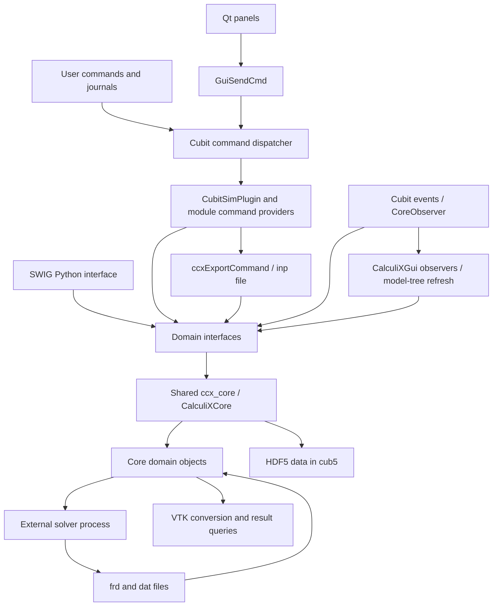

# Architecture overview

[Developer documentation](README.md)

## Runtime structure

cubit-sim is a Cubit extension with command, GUI, shared model, and Python binding layers. Cubit supplies host services such as mesh access, command execution, and file-event notifications. CalculiX runs as an external solver.

The following diagram summarizes calls observed in the source. It is a navigation aid, not an exhaustive dependency graph.

## Entry points and shared state

- [CubitSimPlugin.cpp](../src/Framework/CubitSimPlugin.cpp) registers the loader-facing command plugin with `CUBIT_PLUGIN`. It exposes the workspace command and delegates module command keys/construction through [FrameworkContext](../src/Framework/Core/FrameworkContext.cpp). CalculiX command registration lives in [CalculiXCommands.cpp](../src/CalculiX/Commands/CalculiXCommands.cpp).
- [CubitSimComp.cpp](../src/Framework/CubitSimComp.cpp) is the loader-facing component. It attaches the workspace host through the Framework context. [CalculiXModule.cpp](../src/CalculiX/CalculiXModule.cpp) owns the module lifecycle and core observer registration; [CalculiXGui.cpp](../src/CalculiX/GUI/CalculiXGui.cpp) creates panels, model tree, menus, toolbars and GUI observer callbacks. The component binding is declared in [cubitsim_comp.i](../src/Framework/cubitsim_comp.i).
- [loadCalculiXCore.cpp](../src/CalculiX/Core/loadCalculiXCore.cpp) defines one global `CalculiXCore ccx_core`. [Domain interfaces](developer/interface-layout.rst) forward operations to this shared instance. Constructing an interface does not create an independent model.
- [CalculiXCore.hpp](../src/CalculiX/Core/CalculiXCore.hpp) declares coordination operations. [CalculiXCoreInitialization.cpp](../src/CalculiX/Core/application/CalculiXCoreInitialization.cpp) implements `init()`, `init2()` and Python initialization; [CalculiXCoreMaintenance.cpp](../src/CalculiX/Core/application/CalculiXCoreMaintenance.cpp) implements updates/reset, and [CalculiXCorePersistence.cpp](../src/CalculiX/Core/application/CalculiXCorePersistence.cpp) implements model read/save. The destructor remains in [CalculiXCore.cpp](../src/CalculiX/Core/CalculiXCore.cpp). Domain-specific coordination is split across the corresponding Core directories.

The core depends on Cubit and Qt: it is not a standalone solver or a host-independent data library. See the `calculix_core` link dependencies in [CalculiX/CMakeLists.txt](../src/CalculiX/CMakeLists.txt).

## Commands, GUI, and model updates

Commands define syntax, help, and an `execute(CubitCommandData&)` method. For example, [ccxDampingModifyCommand.cpp](../src/CalculiX/Commands/steps/ccxDampingModifyCommand.cpp) reads optional alpha/beta values, converts numbers to strings, and passes values plus presence markers through the core interface.

[DampingModifyPanel.cpp](../src/CalculiX/GUI/steps/DampingModifyPanel.cpp) constructs the same command text. [GuiSendCmd.cpp](../src/CalculiX/GUI/application/GuiSendCmd.cpp), `gui_cmd()`, submits text to the native command window through its `commandEntered` method and resets its history index. The return value reports submission, not command success. Previews use the separate `silent_cmd` path.

[CoreObserver.cpp](../src/CalculiX/Core/application/CoreObserver.cpp) handles model operations from host notifications. [Observer.cpp](../src/CalculiX/EventObservers/Observer.cpp) supplies GUI-update callbacks installed by `CalculiXGui`:

- `notify_command_complete()` calls `core_update()` unless blocked and refreshes the GUI immediately or through a timer, subject to update flags.
- `notify_model_reset()` resets both the core and component view.
- File-read and file-save notifications call the persistence methods. Temporary file saves are explicitly skipped.

Tree display data also passes through the interface. For damping, [CalculiXCoreStepSettings.cpp](../src/CalculiX/Core/steps/CalculiXCoreStepSettings.cpp) implements `CalculiXCore::get_damping_tree_data()` for ID/name rows consumed by [DampingTree.cpp](../src/CalculiX/GUI/steps/DampingTree.cpp).

## User options

The framework owns one `cubitcubitsim_user_options.h5` in Cubit's standard settings directory. If the SDK cannot resolve a settings directory, the startup working directory is used. The absolute filename is retained for the session. Each workspace supplies explicit typed defaults and validators through `UserOptionsInterface`; CalculiX declarations live in `CoreUserOptions.cpp`. Saved values are validated before populating `ccx_uo`. Resource defaults remain relative to the framework component directory. The options store is implemented in `cubitsim_storage`, and modules receive its interface during initialization, avoiding a link dependency back to the framework host. The framework registers workspace-owned options widgets with Cubit. CalculiX editing runs through a replayable command. `ccx.cfg` is no longer read or written. See [the contract](developer/user-options.rst).

## Model representation and persistence

Domain objects such as `CoreSections`, `CoreSteps`, and `CoreDamping` hold feature state. Many interfaces use positional vectors rather than named record fields. For example, [CoreDamping.hpp](../src/CalculiX/Core/steps/CoreDamping.hpp) defines `damping_data[0]` as alpha and `[1]` as beta. Empty strings represent unset coefficients; an explicit zero is a different stored value.

`CalculiXCore::read_cub()` and `save_cub()` use the shared framework storage library `cubitsim_storage` and its [HDF5Tool](../src/Framework/Storage/HDF5Tool.hpp) to read/write groups beneath `cubit-sim` in the model file. Damping uses the rank-one string dataset `cubit-sim/Damping/damping_data`. The reader rejects the legacy `.cub` extension and directs users to `.cub5`.

Changing vector layout is therefore potentially a file-format change. Check initialization, reset, readers, writers, display consumers, and exports together. The damping reader fills two empty entries when its dataset is empty; that is not proof of a general migration mechanism.

## Export, solving, and results

[ccxExportCommand.cpp](../src/CalculiX/Commands/export/ccxExportCommand.cpp) orchestrates `.inp` output: preparation, mesh nodes/connectivity and sets, model keyword sections, steps, and cleanup. It combines Cubit mesh-export access with core-generated keyword text. For example, `write_damping()` writes `get_damping_export_data()`.

[CoreDamping.cpp](../src/CalculiX/Core/steps/CoreDamping.cpp), `get_damping_export_data()`, emits `*DAMPING` when at least one coefficient is set, appends the set parameters, and includes custom lines before/after the keyword. [CoreSteps.cpp](../src/CalculiX/Core/steps/CoreSteps.cpp) is a separate inspection point for step-dependent features.

[CoreJobs.cpp](../src/CalculiX/Core/jobs/CoreJobs.cpp) creates/manages jobs, starts external processes in `run_job()`, waits or kills them, and checks completion in `check_jobs()`. Windows and non-Windows process handling have separate branches. Completion handling includes result loading and conditional conversion.

[CoreResults.cpp](../src/CalculiX/Core/results/CoreResults.cpp) maintains job-to-result associations and loads FRD/DAT readers. The [VTK converter](developer/vtk-conversion.rst) builds complete in-memory datasets using bounded Boost tasks and exposes them through `CalculiXResultsInterface`. Job completion builds datasets synchronously; a separate
XML exporter writes optional VTU/VTPC/VTT/PVD output. The old `CoreResultsVtkWriterLegacy` is archived without build bindings or active callers. Python query methods in [CalculiXPythonInterface.cpp](../src/CalculiX/PythonInterface/CalculiXPythonInterface.cpp) forward through the Jobs, Topology, FRD, DAT and Loads interfaces.

For a complete step-dependent feature trace, see the [surface-traction walkthrough](adding-a-feature.md), including its conversion from distributed total force components to nodal `*CLOAD` entries.
