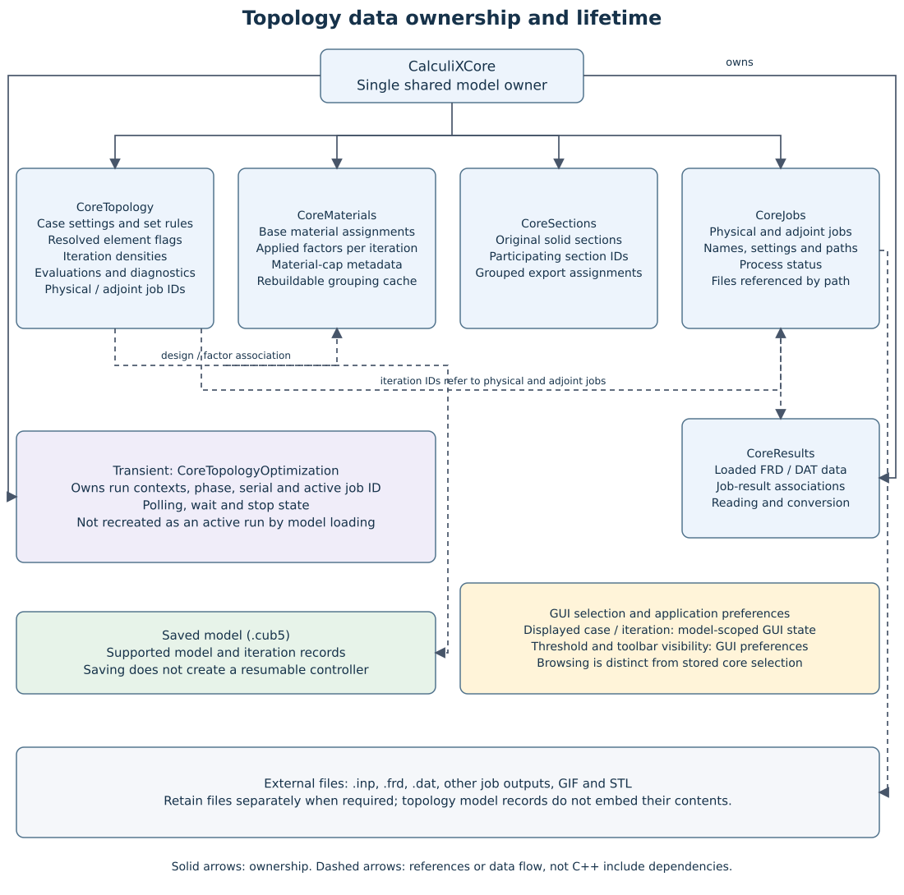

Topology result storage and processing
======================================

This chapter describes the result consumers, persistence, and mesh checks.
See :doc:`topology-algorithms` for objective/update mathematics,
:doc:`../user/topology-results` for the GUI, and
:doc:`../commands/topology-results` for command syntax.

Implementation map
------------------

Paths below are relative to ``src/CalculiX``; source downloads remain
available in the offline manual.

.. list-table:: Current implementation
   :header-rows: 1
   :widths: 30 70

   * - Responsibility
     - Source and operation
   * - Public iteration queries
     - :download:`Core/topology/CalculiXCoreTopologyQueries.cpp <../../src/CalculiX/Core/topology/CalculiXCoreTopologyQueries.cpp>`; :download:`Core/topology/CoreTopologyQuery.cpp <../../src/CalculiX/Core/topology/CoreTopologyQuery.cpp>`. Iteration rows, job associations and validated per-element data.
   * - Stored records and case serialization
     - :download:`Core/topology/CoreTopologyStructs.hpp <../../src/CalculiX/Core/topology/CoreTopologyStructs.hpp>`; :download:`Core/topology/CoreTopology.cpp <../../src/CalculiX/Core/topology/CoreTopology.cpp>`. ``TopologyCase``, ``TopologyDensityDesign`` and ``TopologyIterationEvaluation``; ``save_configuration`` and ``read_configuration``.
   * - Cross-domain persistence
     - :download:`Core/topology/CoreTopologyPersistence.cpp <../../src/CalculiX/Core/topology/CoreTopologyPersistence.cpp>`; :download:`Core/application/CalculiXCorePersistence.cpp <../../src/CalculiX/Core/application/CalculiXCorePersistence.cpp>`. ``CoreTopologyPersistence::read``/``write`` coordinate case records with derived material and section data during model persistence.
   * - Iteration completion and selection
     - :download:`Core/topology/CalculiXCoreTopologyIteration.cpp <../../src/CalculiX/Core/topology/CalculiXCoreTopologyIteration.cpp>`; :download:`Core/topology/CoreTopologyIteration.cpp <../../src/CalculiX/Core/topology/CoreTopologyIteration.cpp>`. ``mark_completed`` and ``select_iteration`` validate the stored iteration and job association.
   * - Preview and animation
     - :download:`Core/drawing/CoreDrawTopology.cpp <../../src/CalculiX/Core/drawing/CoreDrawTopology.cpp>`; :download:`Core/drawing/TopologyAnimation.cpp <../../src/CalculiX/Core/drawing/TopologyAnimation.cpp>`. ``draw_topology`` builds retained/removal geometry; the animation controller captures and encodes frames.
   * - Mesh projection
     - :download:`Core/results/CoreResultsProject.cpp <../../src/CalculiX/Core/results/CoreResultsProject.cpp>`. Threshold-based topology projection and deletion.
   * - Management and toolbar
     - :download:`GUI/topology/TopologyManagement.cpp <../../src/CalculiX/GUI/topology/TopologyManagement.cpp>`; :download:`GUI/topology/TopologyManagementIterations.cpp <../../src/CalculiX/GUI/topology/TopologyManagementIterations.cpp>`; :download:`GUI/drawing/CalculiXTopologyToolbar.cpp <../../src/CalculiX/GUI/drawing/CalculiXTopologyToolbar.cpp>`. Explicit displayed iteration selection and existing command submission; GUI state is distinct from stored core selection.

Stored records and ownership
----------------------------

y by saving topology records.

   Solid arrows indicate ownership; dashed arrows indicate references or data
   flow. The diagram describes data responsibility, not direct header dependencies
   between domain cores. Domain interfaces remain the communication boundary.

``CoreTopology`` owns cases and their density/level-set iteration designs, objective
evaluations, volume/convergence diagnostics, physical and adjoint job
associations, and resolved element-preservation flags. Preservation flags are
case run data, shared by the designs in that run. Density designs retain their
interpolation parameters and update diagnostics.

The material core owns the topology material collection, including base
material assignments and per-iteration stiffness factors. Job records belong
to the job core. ``CalculiXCore`` coordinates these stores through its existing
interfaces. Consumers must not introduce direct dependencies between domain
core headers; cross-core access goes through the domain-specific interfaces (see :doc:`interface-layout`).

``CalculiXCore::get_topology_iteration_element_data`` checks the iteration job
is finished and an evaluation, method-matching design, and factor map exist. It checks
coverage against preservation and base material assignments and validates
positive IDs, finite solid fractions/factors, and their bounds. Each returned row is:

.. code-block:: text

   [global_element_id, solid_fraction, stiffness_factor, preserved_flag]

For density designs the solid fraction is the density; for level set it is the
regularized element fraction, including zero for void. Stiffness factors remain
strictly positive. Preserved elements require fraction and factor equal to one.
``get_topology_iteration_method`` reports the captured historical method;
editing the case method does not reinterpret earlier results. The existing
13-column iteration query retains its layout; its design-change column reports
density change or available nodal field change according to that captured method.

The flag is zero or one. Consumers perform their additional mesh checks before
using these rows. An empty result signals unavailable or invalid data.

Displayed versus selected iteration
-----------------------------------

``TopologyCase::selected_iteration`` is the stored core selection; -1 means
none. Completing an iteration updates it. The core selection API validates a
finished, evaluated iteration before changing it. Element-data requests with
iteration -1 resolve through this field rather than searching for the newest
iteration themselves.

``TopologyManagement`` maintains its own displayed case and iteration.
Opening a case initially chooses the last completed entry when no previous or
explicit selection applies. Browsing the dropdown does not call the core
selection API. Panel preview, deletion, and wrapping pass explicit iteration
IDs; GIF export passes a case ID and processes all eligible iterations.
This distinction must remain clear in UI labels and command documentation.

Tree and panel availability
---------------------------

``TopologyTree`` maps case run states to topology-specific icons. Both
``converged`` and ``iteration_limit`` use the finished icon. Its iteration icons
use physical job status; completion for browsing additionally requires a stored
objective. Each iteration's job child refers to the physical job.

``TopologyManagement`` lists evaluated entries with finished physical jobs.
It validates that the displayed job still matches the iteration association.
Mesh operations additionally require an idle case and available stored
elements. ``meshAvailable`` checks that returned global element IDs are valid
and still exist in Cubit. Job inspection can remain available when mesh actions
are disabled. Reloading refreshes the lists without reconstructing a run.

Save and load
-------------

``CoreTopology::save_configuration`` writes a single required current layout
below ``Cubit-CalculiX/Topology``. No topology format version or migration path
is stored. Older or incomplete topology layouts fail with a Cubit error; missing
current fields are not replaced by defaults. An absent topology group represents
a model without topology cases.

The archive stores case settings (including level-set settings), preservation
rules, job associations, designs and common evaluations. Level-set designs retain
nodal coefficients, fixed nodes, solid fractions, captured settings, seed origin,
volume diagnostics and incoming update diagnostics. Evaluations retain their own
method tag, nodal derivatives and source proposal diagnostics. Material factors,
base assignments and material-cap markers remain owned by the material core.
Transient material-group caches are rebuilt from saved factors.

``CoreTopologySaveValidation`` checks numeric records, domains, method/design
consistency, source links and selected-iteration completeness without consulting
the current Cubit mesh. Material coverage is checked against stored preservation
and assignments. Prepared unsolved designs and failed-stage physical objectives
can be retained; a usable objective does not require an outgoing proposal.

Validation precedes replacement of the topology group during save; this does not
make the entire HDF5 write transactional. Loading stages records before committing
the collection. A case saved as running is restored as failed with an
interrupted-run message. Active proposals, sparse operators, controller contexts
and process handles are not restored, and loading never restarts a solver.

GUI timers, the displayed dropdown entry, preview state, and playback are
transient widget state. Persisted core selection is a different field. Stored
iteration records are not a geometry snapshot and do not reconstruct mesh
elements removed after optimization. External solver files are not made
portable merely by saving the topology records; preserve files required by
the job/result workflows separately.

Preview and playback
--------------------

``CoreDraw::draw_topology`` resolves global element IDs to Cubit volume entity
kinds and local IDs before drawing. The classification is
``!preserved && density < threshold`` for removal; all others are retained.
Retained elements are green and removal candidates have red edges.

The Topology Management and tree call previews through ``silent_cmd``. Other GUI
actions, including deletion and exports, use the ordinary GUI command path.
The panel guards against reentrant preview calls and defers automatic preview
requests through a short single-shot timer. Playback advances the available
iteration entries, draws each explicitly, then schedules its next timer.
Rendering time adds to the requested interval; this is not a real-time frame
rate guarantee. It stops at the final entry or when availability is lost.

GIF capture and wrapping
------------------------

``CoreDraw::animate_topology`` starts a ``TopologyAnimation`` controller. It
snapshots eligible iteration IDs, validates output settings, and schedules one
silent preview/hardcopy per GUI-thread timer callback. Startup returns before
capture is complete. No Cubit or widget access occurs on the encoding worker.

After capture, the controller moves its temporary directory into a worker using
``std::async``. ``GifAnimation`` receives atomic cancellation/progress values and
returns errors through a string, without calling Cubit logging. The worker
encodes, publishes, and removes temporary PNGs before returning. A GUI timer
polls readiness without waiting and reports progress/completion on the main
thread. Replacement uses ``QSaveFile``; without overwrite, ``QFile::copy``
refuses an existing output, including one created after startup.

Cancellation is cooperative between captures/encoded frames and replacement
copy chunks. A completed publication remains successful even if cancellation
arrives afterwards. Reset/load requests cancellation; shutdown joins any file
worker before destroying plugin-owned code. The Topology Management polls active
state, stops competing preview timers, and exposes cancellation. Generic Cubit
commands can still change the graphics view, so users must keep it unchanged
during capture. This uses the current view, not a stored camera snapshot, and
does not restore the previous display. Topology drawing compresses consecutive
IDs into ranges and bounds batches by command length.

``ccxWrapCommand`` collects the threshold-selected volume mesh through
``collect_topology_wrap_mesh``. It validates the entire stored design against
the current mesh before building the retained input. Preserved elements are
included regardless of density. Boundary extraction and corner-node
approximation feed the existing CGAL alpha-wrap workflow. The command supplies
automatic or explicit alpha/offset and optionally imports the resulting STL.

Deletion and partial failure
----------------------------

``CoreResultsProject::project_topology`` rejects a running case, validates all
stored rows, checks element existence and volume kind, and groups removal
candidates by hex, tet, or wedge local IDs. It prepares all deletion commands
before modifying the mesh, batching up to 200 volume elements per command.

With preview enabled, it delegates to drawing. Otherwise it enables developer
commands if necessary, executes deletion through ``silent_cmd``, and restores
the previous developer-command setting on exit. Restoring that setting does
not restore deleted elements.

Failure stops further batches. Earlier batches remain deleted, and the failed
batch may itself have changed the mesh. A subsequent display failure can return
false after successful deletion. Callers must therefore not interpret a false
return as proof that the mesh is unchanged. The Topology Management refreshes its
availability checks after deletion without assuming command success.

Mesh identity limits
--------------------

The current checks detect missing IDs and unsupported element kinds. They do
not establish that an existing ID still has its original coordinates,
connectivity, or assignments. Reusing IDs after remeshing can therefore pass
existence checks without representing the optimized model. Preview and wrapping
use current coordinates, while densities and evaluations describe the stored
optimization run. There is no mesh fingerprint or automatic restoration.

Keep historical records for numerical inspection, but use their mesh operations
with the corresponding unchanged mesh. After deliberate deletion, create and
validate a normal analysis of the remaining mesh rather than treating the
historical solve as a verification of that modified model.

Topology Management source layout
---------------------------------

``GUI/topology/TopologyManagement.hpp`` declares one window class. Its main source
owns case selection, lifecycle and refresh. Preservation, Run, Iterations, Animation and Wrap translation units implement
that same class. The Settings translation unit owns Method selection and a
QStackedWidget with independent TopologyManagementDensitySettingsWidget and
TopologyManagementLevelSetSettingsWidget forms. Each form owns complete fields,
drafts and command construction; submission uses the management command guard.
Navigation uses separate TopologyDensitySettingsPanel and
TopologyLevelSetSettingsPanel classes under Create/Modify method children.
Management does not instantiate command-panel widgets. ``ModelTree`` owns the window as a
parented Qt window, reuses it on activation, and clears it on model reset.
``GUI/cgal/AlphaWrapPanel`` independently submits the existing wrap commands.

Solid preview geometry uses Cubit/Exodus corner connectivity to construct faces
and unique edges. It does not require explicit interior face/edge entities from
Cubit. Higher-order elements use a corner-node display approximation. Export
exceptions report the current pipeline stage, and scope guards release acquired
interfaces, restore the previous GUI-update flag and clean interrupted export
preparation/progress. AppUtil owns the borrowed progress tool.

Topology toolbar and native display lifecycle
---------------------------------------------

``CalculiXTopologyToolbar`` owns independent controls and queries completed
iteration rows through the topology interface. Preview uses the existing silent
project command; hiding uses the display command. The draw interface exposes
only the current preview case, iteration and threshold for synchronization.
Ordinary drawing rebuilds preserve global overlay visibility.

``NativeDisplayRefreshObserver`` owns an empty, delete-on-display SDK drawing set
per live viewport model set. Its disappearance while armed indicates a native
display clear. The observer then disables the global overlay through the draw
interface, avoiding a nested command while Cubit handles its own display action.
Camera repaints do not constitute display clears. Workspace deactivation, model
reset, GIF capture and teardown disarm the observer. Viewports are re-enumerated
before accessing SDK pointers. This also applies to native display operations
that clear temporary drawing sets, not only the context-menu action.

The Framework host registers each toolbar once and persists its intended
visibility separately from hiding an inactive workspace. Layout restoration
preserves native toolbar visibility and restores workspace toolbar placement.

Management and result plot windows are parented auxiliary windows with
``WA_QuitOnClose`` disabled. Jobs Monitor and Jobs tree timers are parented to
their owners. Display-refresh polling starts only in the active workspace,
stops on deactivation or application quit, and avoids graphics SDK access after
Qt teardown begins. These ownership changes address cleanup defects; a runtime
shutdown check is still needed to establish whether a reported lingering Clarox
process is resolved.

The topology toolbar's final Alpha wrap action submits the existing wrap command
with the selected iteration, six-decimal displayed threshold, generated STL name
and ``overwrite``. Alpha and offset remain command defaults; import remains on.
