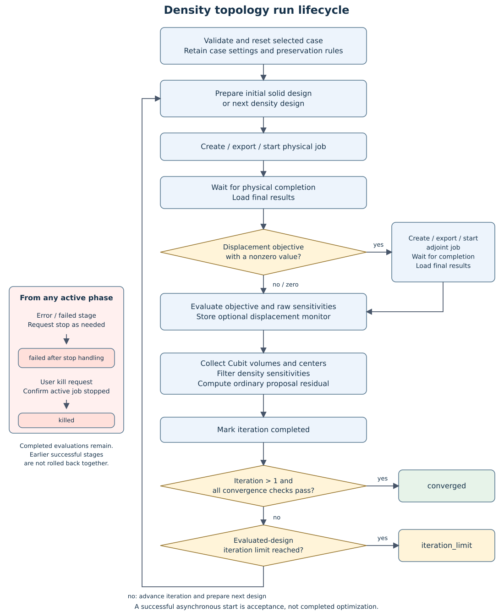

Topology: mathematics and implementation map
============================================

This page establishes the notation and links to the implementing code.
See :doc:`topology-algorithms` for the derivative derivations, integration
conventions, sensitivity filter, update algorithms, and convergence checks.

Linear model and density interpolation
--------------------------------------

For fixed loads, homogeneous prescribed displacements, and the supported
symmetric linear-elastic model:

.. math::

   s_e(\rho_e)=v+(1-v)\rho_e^p,\qquad
   K(\widehat{s})u=\mathbf f,\qquad
   K_e=\widehat{s}_eK_e^{\mathrm{base}}.

Here :math:`s_e` is the requested continuous SIMP factor and
:math:`\widehat{s}_e` is the stored applied factor after exact sharing or
material grouping. The identities describe the ideal factor-scaled model;
export rounding and finite solver/result precision introduce numerical error.
Preserved elements have :math:`\rho_e=s_e=\widehat{s}_e=1`. Their stored design
sensitivities are zero because their densities are not optimization variables.

Compliance
----------

.. math::

   C=\mathbf f^T u=2\sum_e U_e,\qquad
   U_e=\tfrac12u_e^T K_eu_e,\\
   \frac{\partial C}{\partial\widehat{s}_e}
   =-\frac{2U_e}{\widehat{s}_e},\qquad
   g_{C,e}^{\mathrm{sur}}
   =-\frac{2U_e}{\widehat{s}_e}(1-v)p\rho_e^{p-1}.

When applied factors equal the continuous SIMP factors, the chain rule gives
the corresponding continuous-model density derivative. With material grouping,
:math:`g_{C,e}^{\mathrm{sur}}` is a surrogate sensitivity; the implementation
does not differentiate bin assignments or the grouping operation.

Displacement adjoint
--------------------

For a monitored node, the objective is the absolute selected component or the
vector norm. For a nodeset, the implementation selects the node attaining the
maximum. Away from a change in that node or a nondifferentiable zero:

.. math::

   K^T\lambda=\frac{\partial J}{\partial u},\qquad
   \frac{\partial J}{\partial\widehat{s}_e}
   =-\lambda_e^T\frac{\partial K_e}{\partial\widehat{s}_e}u_e.

The component adjoint load is a signed unit load; the magnitude load is
:math:`u/\lVert u\rVert` at the controlling node. The current implementation
uses the zero subgradient at zero monitored displacement and skips the adjoint.

Using physical stress and adjoint mechanical strain:

.. math::

   I_e=\sum_q
   \left(\sigma_e^{\mathrm{physical}}:
   \varepsilon_e^{\mathrm{adjoint}}\right)_q W_{e,q},\qquad
   W_{e,q}=\omega_q^{\mathrm{ref}}\det J_{e,q},\\
   \frac{\partial J}{\partial\widehat{s}_e}
   =-\frac{I_e}{\widehat{s}_e},\qquad
   g_{J,e}^{\mathrm{sur}}
   =-\frac{I_e}{\widehat{s}_e}(1-v)p\rho_e^{p-1}.

The same exact-versus-surrogate distinction applies to displacement. The
physical quadrature weight :math:`W_{e,q}` already contains the Jacobian
determinant and is multiplied into the contraction once.

There is **no factor of one half** in this contraction: it is the bilinear
adjoint product :math:`\lambda_e^T K_eu_e`, not stored strain energy.
For tensor shear components, the contraction uses normal terms once and
the three shear terms twice. Both fields must use matching global coordinates
and CalculiX integration-point IDs.

Configuration and run lifecycle
-------------------------------

limit; otherwise the next design is prepared. Failure and kill requests use stop handling.

   Controller lifecycle. Iteration 1 uses the initial solid design; later passes
   prepare the next density design. Errors and user stops can interrupt active
   stages, so successful earlier stages are not a run-wide transaction.

Defaults belong to ``CoreTopology``. Creation initializes a ``TopologyCase``
with those defaults, applies supplied ``TopologyOptions`` entries, validates
the configuration, and stores it. Each ``has_*`` flag distinguishes an omitted
option from an explicitly supplied value, including zero where allowed.
The GUI and commands must not introduce a competing set of defaults.

Modification rejects an active case, copies the existing configuration,
applies supplied options, validates the copy, and only then replaces the
stored configuration. Selections and iteration records are preserved.
Configuration acceptance does not establish support for running every enum
value: mass and level set remain unavailable in the iteration controller.

``CalculiXCore::begin_topology_run()`` validates the required cores, current
state, supported method/objective, analysis, and displacement selection.
It then calls ``reset_topology_run()`` before marking the case running.
Reset removes associated physical/adjoint job records and clears evaluations,
density designs, resolved preservation flags, selection, and prepared topology
material/section collections. The case settings and explicit preservation
selections remain. Remaining initialization and output preparation occur in
the controller, so a later preparation failure does not restore the old run.

``CoreTopologyOptimization`` owns the transient run context. Its phases are
``Preparing``, ``Starting``, ``Waiting``, ``StartingAdjoint``,
``WaitingAdjoint``, ``Evaluating``, and ``Finished``. The controller advances
these as jobs are polled. A nonzero displacement objective uses an adjoint;
compliance and the zero-displacement branch do not require that extra solve.
Each context has a serial so stale work can be distinguished from a new run.

With ``wait=false``, a successful call establishes startup/acceptance rather
than completion. With ``wait=true``, it enters the wait loop, polls jobs,
processes Qt events, and returns success only for convergence or the iteration
limit. Polling/event processing is not a separate result-reader worker.
Nested waits and waits without a current controller context are rejected.
Persisted case results do not recreate an active controller context on load.

Kill sets ``stop_requested`` and requests polling when possible. Subsequent
advancement terminates the active process and confirms that it is no longer
running before setting the terminal state. A true return from kill therefore
means request acceptance, not guaranteed immediate process termination.
Completed evaluations remain available. A failed run uses the corresponding
stop/termination path with the failed state rather than continuing updates.

Calls between domain cores use the domain-specific interfaces (see :doc:`interface-layout`). ``CalculiXCore``
coordinates its owned collections and Cubit queries; the optimization controller
does not include other domain-core headers to obtain their stored data.

See :doc:`../user/topology-settings`, :doc:`../user/topology-running`, and
:doc:`../commands/topology` for the corresponding public behavior.

Implementation entry points
---------------------------

The files below are relative to ``src/CalculiX``. Source downloads are
included in the offline manual. ``CalculiXCore`` member implementations are
split across domain translation units; their presence in the central class
does not mean their definitions remain in ``Core/CalculiXCore.cpp``.

.. list-table:: Current topology source map
   :header-rows: 1
   :widths: 25 40 35

   * - Responsibility
     - Source
     - Entry points
   * - Public topology API
     - :download:`Core/topology/CalculiXTopologyInterface.hpp <../../src/CalculiX/Core/topology/CalculiXTopologyInterface.hpp>`; :download:`Core/topology/CalculiXTopologyInterface.cpp <../../src/CalculiX/Core/topology/CalculiXTopologyInterface.cpp>`
     - Case settings, public run operations, preservation queries and export context.
   * - Internal run API
     - :download:`Core/topology/CalculiXTopologyRunInterface.hpp <../../src/CalculiX/Core/topology/CalculiXTopologyRunInterface.hpp>`; :download:`Core/topology/CalculiXTopologyRunInterface.cpp <../../src/CalculiX/Core/topology/CalculiXTopologyRunInterface.cpp>`
     - Preparation, result evaluation and density-update operations used by the controller.
   * - Controller and run coordination
     - :download:`Core/topology/CoreTopologyOptimization.cpp <../../src/CalculiX/Core/topology/CoreTopologyOptimization.cpp>`; :download:`Core/topology/CalculiXCoreTopologyRun.cpp <../../src/CalculiX/Core/topology/CalculiXCoreTopologyRun.cpp>`
     - ``run_topology``, ``wait_topology``, ``kill_topology`` and the physical/adjoint phase transitions.
   * - Case state and numerical operations
     - :download:`Core/topology/CoreTopology.hpp <../../src/CalculiX/Core/topology/CoreTopology.hpp>`; :download:`Core/topology/CoreTopology.cpp <../../src/CalculiX/Core/topology/CoreTopology.cpp>`; :download:`Core/topology/CoreTopologyStructs.hpp <../../src/CalculiX/Core/topology/CoreTopologyStructs.hpp>`
     - Configuration defaults, densities, objective derivatives, filtering, updates and convergence diagnostics.
   * - Cross-domain preparation
     - :download:`Core/topology/CalculiXCoreTopologyModelPreparation.cpp <../../src/CalculiX/Core/topology/CalculiXCoreTopologyModelPreparation.cpp>`; :download:`Core/topology/CoreTopologyModelPreparation.cpp <../../src/CalculiX/Core/topology/CoreTopologyModelPreparation.cpp>`
     - ``initialize_topology`` and ``initialize_topology_run_design`` prepare the domain and material assignments.
   * - Density and iteration storage
     - :download:`Core/topology/CalculiXCoreTopologyDensity.cpp <../../src/CalculiX/Core/topology/CalculiXCoreTopologyDensity.cpp>`; :download:`Core/topology/CoreTopologyDensity.cpp <../../src/CalculiX/Core/topology/CoreTopologyDensity.cpp>`; :download:`Core/topology/CoreTopologyIteration.cpp <../../src/CalculiX/Core/topology/CoreTopologyIteration.cpp>`
     - ``set_topology_iteration_densities``, ``set_densities``, completion and selected-iteration validation.
   * - Queries and persistence
     - :download:`Core/topology/CalculiXCoreTopologyQueries.cpp <../../src/CalculiX/Core/topology/CalculiXCoreTopologyQueries.cpp>`; :download:`Core/topology/CoreTopologyQuery.cpp <../../src/CalculiX/Core/topology/CoreTopologyQuery.cpp>`; :download:`Core/topology/CoreTopologyPersistence.cpp <../../src/CalculiX/Core/topology/CoreTopologyPersistence.cpp>`
     - Read iteration records and element data; serialize case settings and stored run data.

Export/result helpers are mapped in :doc:`topology-export`, preservation
helpers in :doc:`topology-preservation`, and result consumers in
:doc:`topology-results`.

``ElementIntegration::calculate_weights`` produces physical quadrature weights
using Cubit/Exodus coordinates and CalculiX integration rules. The shared
``ElementNodeOrdering`` helper converts local connectivity positions; its
element-type IDs must match the installed Cubit SDK.

Cross-core operations pass through the domain-specific interfaces (see :doc:`interface-layout`); geometry and
materials are supplied through the existing core and Cubit interfaces.

See :doc:`topology-verification` for verification scope and evidence status.
See :doc:`../user/topology` for the user workflow.
