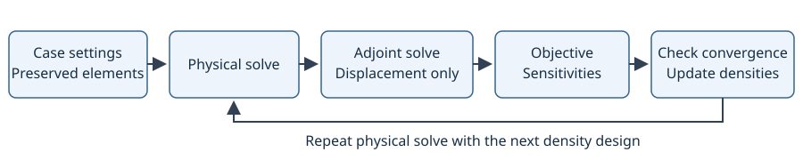

Topology optimization: first workflow
=====================================

Purpose and scope
-----------------

A topology case stores optimization settings, preserved-element selections,
and iteration results. Density optimization changes each free element's
stiffness; the physical CalculiX analysis is solved again for each iteration.

The current density run loop supports compliance and displacement objectives.
Mass and level-set optimization are not implemented. Supported volume elements
are C3D4, C3D6, C3D8, C3D10, C3D15, and C3D20. The shared validator excludes
C3D8R from both compliance and displacement runs. Consult the model validation
errors for further analysis
restrictions; support for an element alone does not make every analysis suitable.

   Iteration workflow. Displacement optimization uses an adjoint solve when
   the monitored objective is nonzero.

Density and stiffness
---------------------

The solid fraction :math:`\rho_e` determines the stiffness multiplier:

.. math::
   :label: simp-stiffness

   s_e(\rho_e) = v + (1-v)\rho_e^p,
   \qquad K_e = s_e K_e^{\mathrm{base}}.

Here :math:`v` is the void stiffness ratio and :math:`p` is the density
penalization (currently 3). Preserved elements have density and stiffness
multiplier equal to 1. A low density represents low stiffness during the run;
it does not delete the element.

Configuration and execution
---------------------------

See :doc:`topology-settings` for defaults and parameter meanings, and
:doc:`topology-running` for asynchronous execution, stopping, and rerunning.
See :doc:`topology-preservation` for automatic preservation, set overrides,
overlaps, and their effect on volume feasibility and element removal.

Run a prepared model
--------------------

This snippet assumes a meshed model, material/section assignments, and a valid
linear static analysis with loads and boundary conditions already assigned to
its step. Nodeset 3 must exist and contain the nodes to monitor.

.. code-block:: text

   ccx create topology 1 name "beam_displacement" method density objective displacement displacement_nodeset 3 displacement_component y volume_fraction 0.7 iterations 20
   ccx run topology 1 wait

Omit ``wait`` for an asynchronous run. See :doc:`../commands/topology` for the
run, wait, and kill commands. Each iteration owns a physical job; displacement
evaluation also creates an adjoint job when required. Iteration IDs start at 1.

After reviewing results, preview an iteration using:

.. code-block:: text

   ccx result project topology 1 iteration 3 threshold 0.5 preview

Preview shows the retained elements and the edges of removal candidates.
Omitting ``preview`` applies the threshold and deletes eligible elements.
Preserved elements are excluded from removal. Review the preview before
applying it; projection does not create a restoration point.

Runnable example
----------------

Download the :download:`complete displacement beam journal <../../examples/topology/simple_beam_displacement.jou>`.
It resets the current model, prepares the analysis, and creates a displacement
topology case with a maximum of 50 iterations. The run command is commented
out. Follow :doc:`../tutorials/topology-beam` to run and inspect the case.
The short command snippet above is not a standalone model.

What CalculiX receives
----------------------

The plugin exports element stiffness through element-specific isotropic elastic
material definitions and solid sections. The physical solve supplies global
displacement results and element stress/energy data. Displacement sensitivity
evaluation contracts physical stress with adjoint mechanical strain at matching
CalculiX integration points. The run preparation checks and configures required
output requests through the existing command mechanisms.
See :doc:`topology-solver` for supported analyses, automatic requests, and the
results consumed by each evaluator. See :doc:`../developer/topology-export`
for annotated input excerpts.

For solver semantics, consult the CalculiX manual matching your solver version:
``*ELASTIC``, ``*SOLID SECTION``, ``*NODE PRINT``, and ``*EL PRINT``. The
`CalculiX documentation page <https://www.calculix.de/>`_ is an online reference;
the manual itself is not bundled with this documentation. CalculiX 2.23 source
was used to cross-check the integration formulas; the recorded verification
runs used the locally configured solver. Keep these versions distinct when
reproducing or extending the checks.

Implementation and verification
-------------------------------

See :doc:`topology-results` for iteration browsing, threshold previews,
playback, GIF export, wrapping, and element deletion.
See :doc:`../developer/topology` for the implementation map,
:doc:`../developer/topology-algorithms` for the mathematical derivations, and
:doc:`../tutorials/index` for the finite-difference journals.
