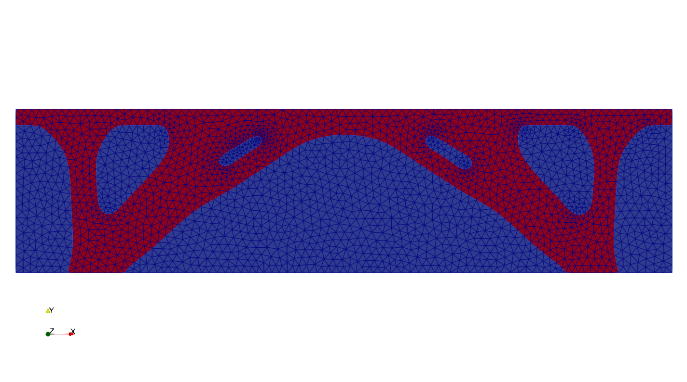

.. This file is subject to the terms and conditions defined in
   file 'LICENSE', which is part of this source code package.

Topology optimization of a 2D bridge using body-fitted meshes
========================================================================================

The goal of this tutorial is to run a topology optimization using solely the OpenPisco Python library.

Test case
~~~~~~~~~~~~~~~~

Consider the following specifications

* domain of size :math:`8` m :math:`\times 2` m
* elastic material with Young modulus equal to :math:`1` Pa and Poisson ratio equal to  :math:`0.3`
* beam clamped on two regions on the plane :math:`y=0` and submitted to a vertical load g = :math:`(0, -0.002)` N on the plane :math:`y=2`
* minimization of the compliance under a volume constraint

Data setting : imports
~~~~~~~~~~~~~~~~~~~~~~~~~~~~~~~~

We start by editing a Bridge.py file and importing all the needed modules

.. code-block::

    import numpy as np

    from Muscat.MeshTools.MeshCreationTools import CreateSquare
    from Muscat.ImplicitGeometry.ImplicitGeometryObjects import CreateImplicitGeometryPlane, ImplicitGeometryHoles,CreateImplicitGeometryAnalytical
    from Muscat.ImplicitGeometry.ImplicitGeometryOperators import ImplicitGeometryUnion, ImplicitGeometryIntersection
    from Muscat.MeshContainers.Filters.FilterObjects import ElementFilter
    from Muscat.IO.XdmfWriter import XdmfWriter

    from OpenPisco.Unstructured.Levelset import LevelSet
    from OpenPisco.PhysicalSolvers.UnstructuredFEAGenericSolver import CreateUnstructuredFEAGenericProblem
    from OpenPisco.Optim.Problems.OptimProblemTopoGeneric import OptimProblemTopoGeneric
    from OpenPisco.Optim.Criteria.GeoCriteria import TopoCriteriaVolume
    from OpenPisco.Optim.Criteria.PhyCriteria import TopoCriteriaCompliance
    from OpenPisco.Optim.Algorithms.OptimAlgoNullSpace import OptimAlgoNullSpace

Data setting : implicit zones
~~~~~~~~~~~~~~~~~~~~~~~~~~~~~~~~

Define implicit zones

.. code-block::

    IGHoles = ImplicitGeometryHoles()
    IGHoles.r = 0.2
    IGHoles.n = np.array([6., 4., 2.])
    IGHoles.type = "Original"

    IGGeometryPlane = CreateImplicitGeometryPlane({"point": [0, 1.8, 0], "normal": [0, -1, 0]})

    IGAnalytical1 = CreateImplicitGeometryAnalytical({"expr": "x-1 "})
    IGAnalytical2 = CreateImplicitGeometryAnalytical({"expr": "x-7 "})
    IGAnalytical2.insideOut = True
    IGAnalytical3 = CreateImplicitGeometryAnalytical({"expr": "y-0.01 "})

    IGUnion = ImplicitGeometryUnion([IGAnalytical1,IGAnalytical2])
    IGIntersection = ImplicitGeometryIntersection([IGUnion,IGAnalytical3])

Data setting : grids
~~~~~~~~~~~~~~~~~~~~~~~~~~~~~~~~~~~~~~~~~~~~~~~~~~~~~~~~~~~~~~~~~~~~~~~~~~~~~~~~~~~~~~~~~~~~~~~~

Define the initial background mesh which is a uniform grid

.. code-block::

    dimensions = np.array([25,20])
    length = np.array([8,2])
    mesh= CreateSquare(dimensions=dimensions, spacing=length/(dimensions-1), origin=[0,0], ofTriangles=True)

Add ridges and corners to the mesh

.. code-block::

    for _,data,_ in ElementFilter(dimensionality=1)(mesh):
        data.tags.CreateTag("Ridges",False).SetIds(np.arange(data.GetNumberOfElements()))

    mesh.nodesTags.CreateTag("Corners",errorIfAlreadyCreated=False).Merge(other=mesh.nodesTags[ "x0y0"])
    mesh.nodesTags.CreateTag("Corners",errorIfAlreadyCreated=False).Merge(other=mesh.nodesTags[ "x1y0"])
    mesh.nodesTags.CreateTag("Corners",errorIfAlreadyCreated=False).Merge(other=mesh.nodesTags[ "x0y1" ])
    mesh.nodesTags.CreateTag("Corners",errorIfAlreadyCreated=False).Merge(other=mesh.nodesTags[  "x1y1" ])

Create mesh tag on elements of dimensionality equal to 1 for Dirichlet boundary condition

.. code-block::

    ff = ElementFilter()
    ff.SetZones([IGIntersection])
    ff.SetDimensionality(1)
    for _,data,ids in ff(mesh):
        data.tags.CreateTag("Dirichlet").SetIds(ids)

Print the mesh

.. code-block::

    print(mesh)

Data setting : levelsets
~~~~~~~~~~~~~~~~~~~~~~~~~~~~~~~~

Define the level set together with a set of options. A set of meshing options are defined to drive the remeshing process.

.. code-block::

    levelset = LevelSet(support=mesh)
    levelset.conform = True
    levelset.MesherInfo = {"gradientMethod":"gradPhi","hmax":0.1,"hmin":0.01,"rmc":1e-5,"hausd":0.01,"nr":True,"iso":0.0}

    IGHoles.SetSupport(levelset.support)
    levelset.phi = IGHoles(levelset.support)

Data setting : physical problems
~~~~~~~~~~~~~~~~~~~~~~~~~~~~~~~~~~

Define the physical problem, which is a linear elastic static problem.

We define material properties, one dirichlet condition and one neumann condition.

The linear solver used is Mumps [2]_.

.. code-block::

    material = ('Material', {'young': '1', 'poisson': '0.3'})
    dirichlet = ('Dirichlet', {'eTag': 'Dirichlet', 'dofs': '0 1', 'value': '0'})
    load = ('Force', {'eTag': 'Y1', 'dir': '0 1', 'value': '-0.002'})
    data = {'type': 'static_elastic', 'p': '1','dimensionality':'2',"linearSolverName":"Mumps",'children':[material,dirichlet,load]}
    physicalSolver = CreateUnstructuredFEAGenericProblem(data)

Data setting : optimization problems
~~~~~~~~~~~~~~~~~~~~~~~~~~~~~~~~~~~~~~~~~~~~

Then, we define the optimization problem by entering the objective, the constraints, the initial levelset, the fixed implicit zone and a set of options.

Note that we have to define an upper bound value for the constraint.

.. code-block::

    res = OptimProblemTopoGeneric()
    volCrit = TopoCriteriaVolume()
    comCrit = TopoCriteriaCompliance()
    res.SetObjectiveCriterion(comCrit)
    res.AddInequalityConstraint(volCrit)
    volCrit.SetUpperBound(0.4*1.55651243e+01)
    comCrit.problem = physicalSolver
    res.point = levelset
    res.ResetState()
    res.OnZone = IGGeometryPlane

Data setting : outputs
~~~~~~~~~~~~~~~~~~~~~~~~~~~~~~~~~~

Define the writer to get the output files

.. code-block::

    writer = XdmfWriter('Bridge2DHistory.xmf')
    print("Opening file :"+writer.fileName)
    writer.SetTemporal()
    writer.SetBinary()
    writer.SetXmlSizeLimit(0)
    writer.Open()
    res.writer = writer

Data setting : optimization algorithms
~~~~~~~~~~~~~~~~~~~~~~~~~~~~~~~~~~~~~~~~~~~~

Then, we define the optimization algorithm which is linked to the optimization problem

.. code-block::

    OA = OptimAlgoNullSpace()
    OA.ResetState()
    OA.alphaC = 0.5
    OA.tol_merit =  0.001
    OA.optimProblem =res

Run
~~~~~~~~~~~~~~~~

Run the topology optimization

.. code-block::

    OA.Start()

To run the script execute in a terminal

.. code-block::

   python Bridge.py

Output
~~~~~~~~~~~~~~~~

After running the tutorial script the following output files have been created in the working directory

* Bridge.xml.log            : run summary
* BridgeHistory.xmf        : (heavy) file containing the mesh and fields at each iteration in xmf format

    Optimal shape (in red)

The demo xml file created is available in the module  :py:meth:`OpenPisco.Demos` of the OpenPisco Python library [1]_ .

.. [1] https://gitlab.com/openpisco/openpisco/-/tree/master/src/OpenPisco/Demos/
.. [2] https://mumps-solver.org/