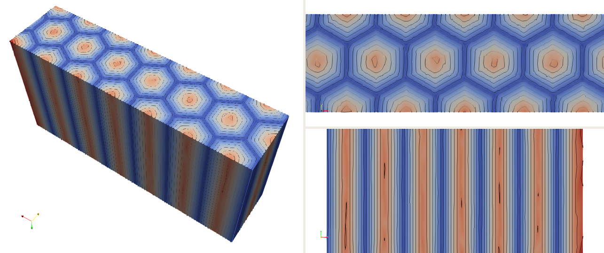
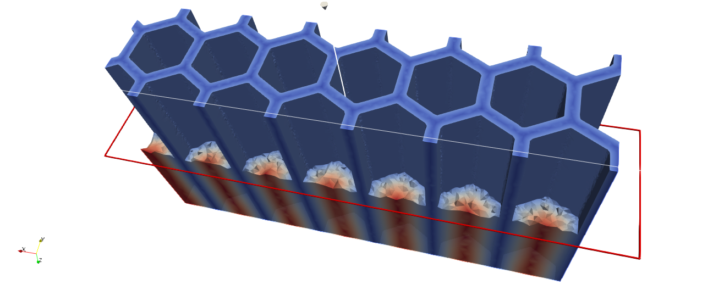

.. This file is subject to the terms and conditions defined in
   file 'LICENSE', which is part of this source code package.

Body-fitted remeshing using implicit geometries and mmg3d
=========================================================

The goal of this tutorial is to create body-fitted meshes using implicit geometries and the remeshing software mmg3d.
In order to do so, we start by editing a HoneyComb.xml file

.. code-block::

    <data dim="3">

We define the honeycomb implicit geometry

.. code-block::

        <Zones>
            <Honeycomb id="1" lx="0.3" w="0.05" desc="honeycomb implicit zone "/>
        </Zones>

We define the initial grid and the conformal level set

.. code-block::

        <Grids>
            <Grid id="1" n="201 51 101" origin="0. 0. 0." length="2.0 0.5 1.0" ofTetras ="True"/>
        </Grids>
        <LevelSets>
            <LevelSet id="1" support="1" conform="True"></LevelSet>
        </LevelSets>

We define the actions to run

.. code-block::

        <Actions>
            <Action type="InitLevelset" ls="1" zone="1"/>
            <Action type="AddEdges" ls="1" ar="90+45" />
            <Action type="Remesh" ls="1" hmax=".4" hmin="0.004" hausd="0.004" iso="0.0" rmc="1e-5"" nr="True"/>
            <Action type="WriteToFile" ls="1" filename="{INPUTFILE}.xdmf" />
        </Actions>

We close the xml file

.. code-block::

    </data>

Run
~~~~~~~~~~~~~~~~

To run the script using the command line application execute in a terminal

.. code-block::

    OpenPiscoCL HoneyComb.xml

To run the script using the GUI application execute in a terminal

.. code-block::

    OpenPisco HoneyComb.xml

Output
~~~~~~~~~~~~~~~~

After running the following output files have been created in the working directory

* HoneyComb.xml.log               : run summary
* HoneyComb.xdmf                  : file containing the body-fitted mesh created

    Honeycomb implicit geometry

    Honeycomb-shaped body-fitted mesh

The demo xml file created is available in the module  :py:meth:`OpenPisco.Demos` of the OpenPisco Python library [1]_ .

.. [1] https://gitlab.com/openpisco/openpisco/-/tree/master/src/OpenPisco/Demos/