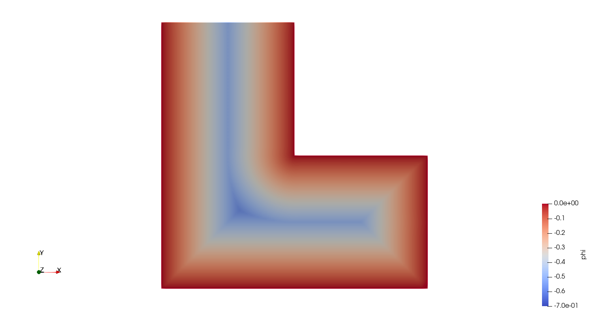
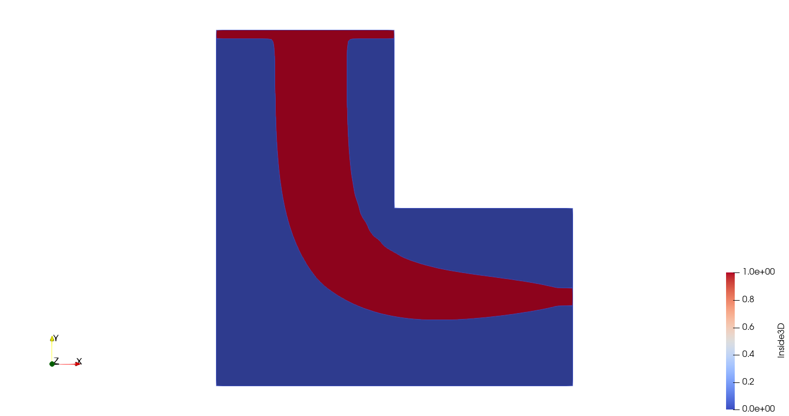
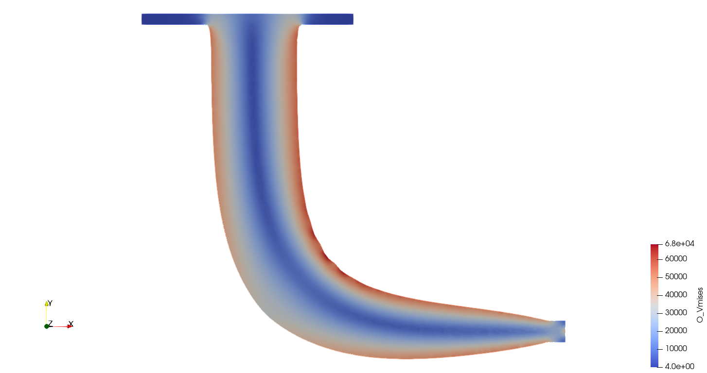

.. This file is subject to the terms and conditions defined in
   file 'LICENSE', which is part of this source code package.

Topology optimization of a 2D L-shaped beam using body-fitted meshes
========================================================================================

The goal of this tutorial is to run a topology optimization of a 2D L-shaped beam using body-fitted meshes.

.. note::
   For running this tutorial Code_Aster [2]_ needs to be installed and available from the command line.

Test case
~~~~~~~~~~~~~~~~

Consider the following specifications

* domain of size :math:`2` m :math:`\times 2` m
* elastic material with Young modulus equal to :math:`210.e9` Pa and Poisson ratio equal to  :math:`0.3`
* beam clamped on the plane :math:`y = 2` m and submitted to a vertical load g = :math:`(0, -1000)` N on the point :math:`(2, 0.5)`
* minimization of the p-norm of Von Mises stress under a volume constraint

Data setting : header
~~~~~~~~~~~~~~~~~~~~~~~~~~~~~~~~

We start by editing a LBeam2D.xml file.

The data file starts with the following header

.. code-block::

    <data dim="2" debug="False" >

Data setting : implicit zones
~~~~~~~~~~~~~~~~~~~~~~~~~~~~~~~~

Define implicit zones

.. code-block::

    <Zones>
        <Plane id="1" point="0.25 1.9999 0.5" normal="0. -1. 0." desc="x0 plane "/>
        <Plane id="2" point="0.25 1.95 0.5" normal="0. -1. 0." desc="dirichlet"/>
        <Sphere id="4" center="2. 0.5 0.0"  radius="0.0009" desc="nodal force"/>
        <Cylinder id="5" center1="1.9 0.5 0." center2="2.1 0.5 0." radius="0.05" desc="force"/>
        <All id="6" ls="1" />
        <AABox id="7" origin="1. 1. 0." size="1.5 2.0 1.0" desc="aabox to delete "/>
        <Union id="8" z="2 5" desc="onzone" />
        <AABox id="9" origin=".05 0. 0." size=".8 2.0 1.0" desc="aabox"/>
        <AABox id="10" origin=".95 0. 1." size="1.5 0.95 1.0" desc="aabox"/>
        <Union id="11" z="2 4 9 10" desc="initialization"/>
        <Sphere id="12" center="1.0 1.0 0.0"  radius="0.0009" desc="corner"/>
        <Sphere id="13" center="1.0 2.0 0.0"  radius="0.0009" desc="corner"/>
        <Sphere id="14" center="2.0 1.0 0.0"  radius="0.0009" desc="corner"/>
    </Zones>

Data setting : grids
~~~~~~~~~~~~~~~~~~~~~~~~~~~~~~~~~~~~~~~~~~~~~~~~~~~~~~~~~~~~~~~~~~~~~~~~~~~~~~~~~~~~~~~~~~~~~~~~

Define the background mesh which is a uniform grid

.. code-block::

    <Grids>
        <Grid id="1" n="61 41" origin="0. 0." length="2.0 2.0" ofSimplex="True"/>
    </Grids>

Data setting : levelsets
~~~~~~~~~~~~~~~~~~~~~~~~~~~~~~~~

Define the level set together with a set of options. The option conform="True" means that the level set is conformal. A set of meshing options are defined to drive the remeshing process.

.. code-block::

    <LevelSets>
        <LevelSet id="1" support="1" conform="True" gradientMethod="gradPhi">
              <MesherInfo hmax=".02" hmin="0.008" iso="0.0" rmc="1e-5"
      nr="True" setPhiZeroOnBoundary="True" keepGeneratedFiles="True"/>
        </LevelSet>
    </LevelSets>

Data setting : physical problems
~~~~~~~~~~~~~~~~~~~~~~~~~~~~~~~~~~

Define the physical problem, which is a linear elastic static problem.

We define material properties, one dirichlet condition and one neumann condition.

By default we use linear elements.

.. code-block::

    <PhysicalProblems>
        <GeneralAster type="static_elastic" id="1" >
            <Material  young="210.e9" poisson="0.3" />
            <Dirichlet eTag="Y1" dofs="0 1" value="0.0"/>
            <Force nTag="nTag4" value="0. -1000" />
         </GeneralAster>
    </PhysicalProblems>

Data setting : outputs
~~~~~~~~~~~~~~~~~~~~~~~~~~~~~~~~~~

Define the desired output

.. code-block::

    <Outputs>
       <Output id="1" name="LBeam2DHistory.xmf" />
       <Output id="2" name="LBeam2DHistory.csv"/>
       <Output id="3" name="PROXY" outputs="1 2" />
    </Outputs>

Data setting : optimization problems
~~~~~~~~~~~~~~~~~~~~~~~~~~~~~~~~~~~~~~~~~~~~

Then, we define the optimization problem by entering the objective, the constraints, the initial levelset, the implicit zones, the output and a set of options.

Note that we have to define an upper bound value for the constraint.

Note that, since the constraint is a physical criterion, we precise which physical problem should be used with the keyword useProblem="1".

The assignement :math:`\alpha=6` means that we choose a :math:`6`-norm for the Von Mises stress criterion.

.. code-block::

    <OptimProblems>
        <OptimProblem type="TopoGeneric" id="1"
            OnZone="8" 
            useLevelset="1"
            printMeshQualityInfo = "True"
            output="3"
            outputEveryLevelsetUpdate = "False">
 
          <Objective   type="VonMises"  name="VonMises" useProblem="1" alpha="6"  />
          <Constraint type="Volume"  name="Volume" UpperBound="0.3*3.00000000e+00" />
       </OptimProblem>
    </OptimProblems>

Data setting : optimization algorithms
~~~~~~~~~~~~~~~~~~~~~~~~~~~~~~~~~~~~~~~~~~~~

Then, we define the optimization algorithm which is linked to the optimization problem

.. code-block::

    <TopologicalOptimizations>
        <OptimAlgoNullSpace id="1"
            useOptimProblem="1"
            numberOfDesignStepsMax="60"
        />
    </TopologicalOptimizations>

Actions setting
~~~~~~~~~~~~~~~~

Here we declare actions which must be runned.

.. code-block::

    <Actions>
        <Action type="DeleteElements" ls="1" zone="7" />
        <Action type="PrintMesh" ls="1" />
        <Action type="AddSkin" ls="1" />
        <Action type="RenameTag" ls="1" eTag="Skin" name="Ridges" />
        <Action type="PrintMesh" ls="1" />
        <Action type="CreateTagsFromZones" ls="1" nodalTags="4 12 13 14" nodalprefix="nTag"/>
        <Action type= "SetAsRequired" ls="1" nTags="nTag4 x0y0 x1y0 x0y1 x1y1 nTag12 nTag13 nTag14" />
        <Action type= "SetAsCorners" ls="1" nTags="nTag4 x0y0 x1y0 x0y1 x1y1 nTag12 nTag13 nTag14" />
        <Action type="InitLevelset" ls="1" zone="6"/>
        <Action type="RunTopoOp" TopoOp="1" />
        <Action type="LsQualityInfo" ls="1" />
    </Actions>
 </data>

    Visualisation of the initial level set field in Paraview

Run
~~~~~~~~~~~~~~~~

To run the script using the command line application execute in a terminal

.. code-block::

    OpenPiscoCL LBeam2D.xml

To run the script using the GUI application execute in a terminal

.. code-block::

    OpenPisco LBeam2D.xml

Output
~~~~~~~~~~~~~~~~

After running the tutorial script the following output files have been created in the working directory

* LBeam2D.xml.log            : run summary
* LBeam2DHistory.xdmf        : (heavy) file containing the mesh and fields at each iteration in xdmf format
* LBeam2DHistory.csv         : convergence history in csv format

    Visualisation of the optimal design in Paraview

    Visualisation of the Von Mises Stress field in Paraview

The demo xml file created is available in the module  :py:meth:`OpenPisco.Demos` of the OpenPisco Python library [1]_ .

.. [1] https://gitlab.com/openpisco/openpisco/-/tree/master/src/OpenPisco/Demos/
.. [2] https://www.code-aster.org/