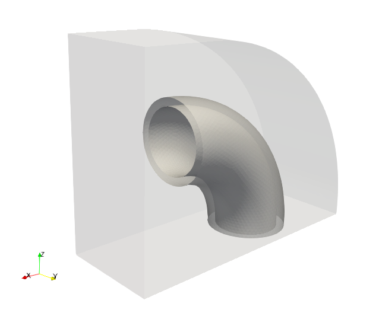
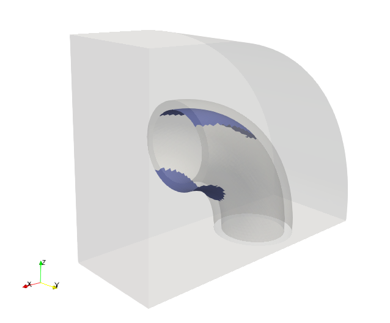

.. This file is subject to the terms and conditions defined in
   file 'LICENSE', which is part of this source code package.

Overhanged surfaces detection for additive manufacturing
=============================================================
The goal of this tutorial is to detect and export overhanged surfaces for additive manufacturing.
At first we start by editing an OverHangDetection.xml file, reading the input mesh model and instanciating a level set

.. code-block::

    <data dim="3" debug="False" >

        <Grids>
            <Mesh id="1" filename="{PISCO_TEST_DATA}TubeMesh.msh" />
        </Grids>

        <LevelSets>
            <LevelSet id="1" support="1" conform="True">
            </LevelSet>
        </LevelSets>

We detect the overhanged surfaces for an input angle of 45 degrees in the direction :math:`(0, 0, 1)`. The keyword surfaceTags is optional and allows to run the overhang detection on specific mesh tags. Read the docstring of :py:class:`OpenPisco.Actions.AdditiveManufacturingActions.OverHangDetectionAction` for the complete list of options. The routine computes the triangle normals to check if the overhang condition is fulfilled. Doing so a tag named"overhangSurface" is filled with the overhanged triangles and added to the mesh tags.

.. code-block::

        <Actions>
            <Action type="OverHangDetection" ls="1" angleDetection="45" surfaceTags="OutsideTube InsideTube" direction="0 0 1"/>

Eventually we export the overhanged surfaces and close the input file

.. code-block::

            <Action type="WriteSurfaceToStl" eTag="overhangSurface" ls="1"/>
        </Actions>
     </data>

    Input model with selected mesh tags "OutsideTube" and "InsideTube"

    Detected overhanged surfaces

The demo xml file created is available in the module  :py:meth:`OpenPisco.Demos` of the OpenPisco Python library [1]_ .

.. [1] https://gitlab.com/openpisco/openpisco/-/tree/master/src/OpenPisco/Demos/
