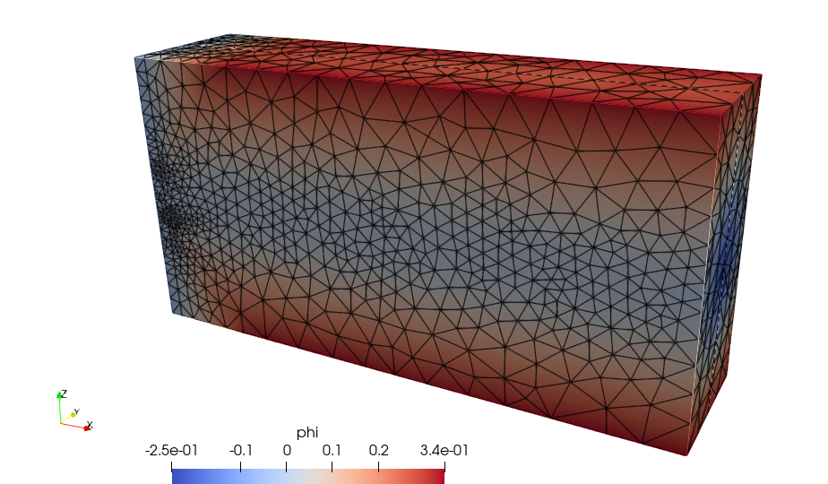
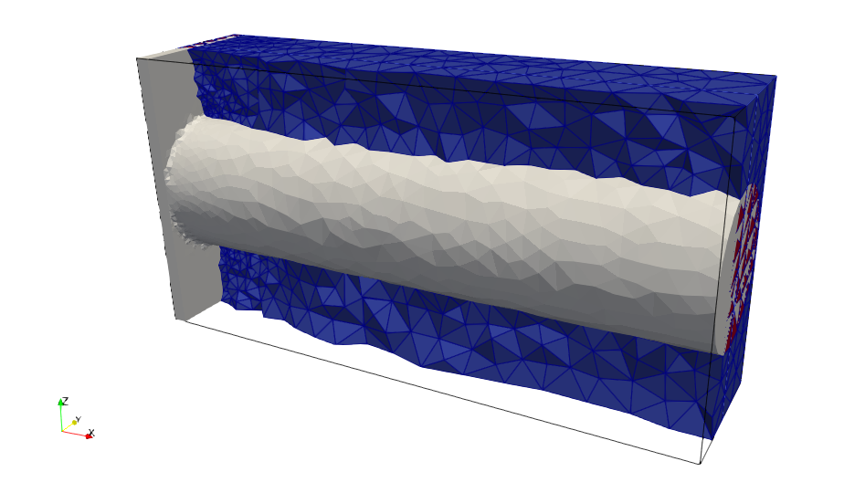
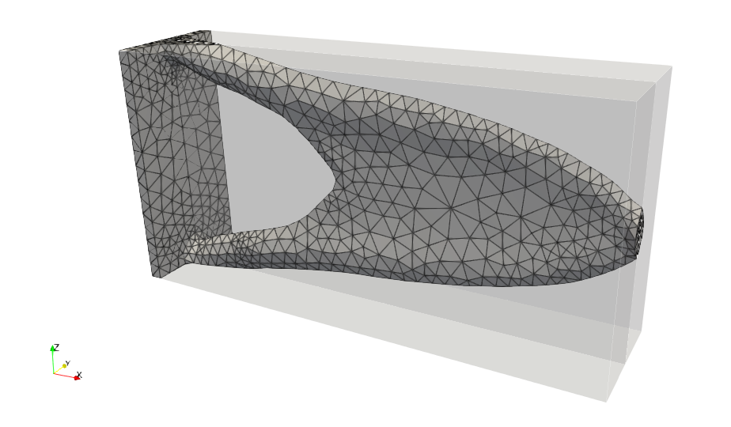
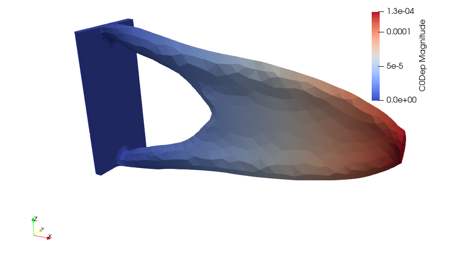

.. This file is subject to the terms and conditions defined in
   file 'LICENSE', which is part of this source code package.

Topology optimization of a 3D cantilever beam using body-fitted meshes
========================================================================================

The goal of this tutorial is to run a topology optimization of a 3D cantilever beam using body-fitted meshes.

.. note::
   For running this tutorial Code_Aster [2]_ needs to be installed and available from the command line.

Test case
~~~~~~~~~~~~~~~~

Consider the following specifications

* domain of size :math:`2` m :math:`\times 0.25` m :math:`\times 1` m
* elastic material with Young modulus equal to :math:`210.e9` Pa and Poisson ratio equal to  :math:`0.3`
* beam clamped on the plane :math:`x = 0` m and submitted to a vertical load g = :math:`(0, 0,  -10000)` N on the point :math:`(2, 0.25, 0.5)`
* minimization of the volume under a compliance constraint

Data setting : header
~~~~~~~~~~~~~~~~~~~~~~~~~~~~~~~~

At first, we start by editing a Cantilever.xml file.

The data file starts with the following header

.. code-block::

    <data dim="3">

Data setting : implicit zones
~~~~~~~~~~~~~~~~~~~~~~~~~~~~~~~~

Define implicit zones

.. code-block::

    <Zones>
        <Plane id="1" point="0.0001 0.25 0.5" normal="1. 0. 0." desc="x0 plane"/>
        <Plane id="2" point="0.05 0.25 0.5" normal="1. 0. 0." desc="dirichlet"/>
        <Plane id="3" point="1. 0.24999 0.5" normal="0. -1. 0." desc="symetry plane"/>
        <Sphere id="4" center="2. 0.25 0.5"  radius="0.0009" desc="nodal force"/>
        <Cylinder id="5" center1="1.9999 0.25 0.5" center2="2.1 0.25 0.5" radius="0.01" desc="force"/>
        <Cylinder id="6" center1="-0.1 0.25 0.5" center2="2.1 0.25 0.5" radius="0.249"/>
        <Union id="7" z="2 4 6" desc="initialization"/>
        <Union id="8" z="2 5" desc="onzone"/>
    </Zones>

Data setting : grids
~~~~~~~~~~~~~~~~~~~~~~~~~~~~~~~~~~~~~~~~~~~~~~~~~~~~~~~~~~~~~~~~~~~~~~~~~~~~~~~~~~~~~~~~~~~~~~~~

Define the background mesh which is a uniform grid

.. code-block::

    <Grids>
        <Grid id="1" n="41 41 41" origin="0. 0. 0." length="2.0 0.25 1.0" ofTetras ="True"/>
    </Grids>

Data setting : levelsets
~~~~~~~~~~~~~~~~~~~~~~~~~~~~~~~~

Define the level set together with a set of options. The option conform="True" means that the level set is conformal. When the body-fitted option is activated a set of meshing options are defined to drive the remeshing process.

.. code-block::

    <LevelSets>
        <LevelSet id="1" support="1" conform="True" gradientMethod="gradPhi">
            <MesherInfo hmax=".5" hmin="0.01" iso="0.0" rmc="1e-5"
            nr="True" computeDistanceWith="meshdist"/>
        </LevelSet>
    </LevelSets>

Data setting : physical problems
~~~~~~~~~~~~~~~~~~~~~~~~~~~~~~~~~~

Define the physical problem, which is a linear elastic static problem.

We define material properties, two dirichlet conditions -clamped part and symetry plane- and one neumann condition.

By default we use linear elements.

.. code-block::

   <PhysicalProblems>
        <GeneralAster type="static_elastic" id="1" >
                  <Material  young="210.e9" poisson="0.3" />
                  <Dirichlet eTag="eTag1" dofs="0 1 2" value="0.0"/>
                  <Dirichlet eTag="eTag3" dofs="1" value="0.0"/>
                  <Force nTag="nTag4" value="0. 0. -10000" />
         </GeneralAster>
    </PhysicalProblems>

Data setting : outputs
~~~~~~~~~~~~~~~~~~~~~~~~~~~~~~~~~~

Define the desired output

.. code-block::

    <Outputs>
       <Output id="2" name="Cantilever.xdmf"/>
       <Output id="3" name="Cantilever.csv" nTag="nTag4" />
       <Output id="1" name="PROXY" outputs="2 3"/>
    </Outputs>

Data setting : optimization problems
~~~~~~~~~~~~~~~~~~~~~~~~~~~~~~~~~~~~~~~~~~~~

Then, we define the optimization problem by entering the objective, the constraints, the initial levelset, the implicit zones, the output and a set of options.

Note that we have to define an upper bound value for the constraint.

Note that, since the constraint is a physical criterion, we precise which physical problem should be used with the keyword  useProblem="1".

.. code-block::

    <OptimProblems>
        <OptimProblem type="TopoGeneric" id="1"
            OnZone="8"
            useLevelset="1"
        printMeshQualityInfo = "True"
            output="3"
            outputEveryLevelsetUpdate = "False">
          <Objective  type="Volume"  name="Volume"/>
          <Constraint type="Compliance"  name="Compliance" UpperBound="2.5*4.69434000e-01"   useProblem="1" />
       </OptimProblem>
    </OptimProblems>

Data setting : optimization algorithms
~~~~~~~~~~~~~~~~~~~~~~~~~~~~~~~~~~~~~~~~~~~~

Then, we define the optimization algorithm which is linked to the optimization problem

.. code-block::

    <TopologicalOptimizations>
        <OptimAlgoNullSpace id="1"
           useOptimProblem="1"/>
    </TopologicalOptimizations>

Actions setting
~~~~~~~~~~~~~~~~

Here we declare actions which must be runned. At first the level set "1" is initialized with the implicit zone "7"

.. code-block::

    <Actions>
        <Action type="InitLevelset" ls="1" zone="7"/>

Then, we add the bounding box edges and the skin to the initial grid. Moreover, we create tags on elements of dimension 2 starting from the implicit zones "1","3". Tags "eTag1","eTag3" are created.

.. code-block::

        <Action type="AddEdges" ls="1" ar="90+45" />
        <Action type="AddSkin" ls="1"/>
        <Action type="CreateTagsFromZones" ls="1" elementTags="1 3" dim="2" elemenprefix="eTag"/>

We create a nodal tag "nTag4" from implicit zone "4" for the nodal force and we set it as required to preserve it during the remeshing

.. code-block::

        <Action type="CreateTagsFromZones" ls="1" nodalTags="4" nodalprefix="nTag"/>
        <Action type= "SetAsRequired" ls="1" nTags="nTag4" />

We perform a remeshing to generate a conformal mesh

.. code-block::

        <Action type="Remesh" ls="1" hmax=".5" hmin="0.01" iso="0.0" rmc="1e-5"
      nr="True" computeDistanceWith="meshdist" />

    Background mesh after a first remeshing

    Cut of the initial body-fitted mesh

Then, we run the topology optimization

.. code-block::

        <Action type="RunTopoOp" TopoOp="1"/>

Eventually the optimal shape is exported in stl format

.. code-block::

        <Action type="SaveShapeToFile" ls="1" filename="Cantilever.stl"/>
    </Actions>
 </data>

Run
~~~~~~~~~~~~~~~~

To run the script using the command line application execute in a terminal

.. code-block::

    OpenPiscoCL Cantilever.xml

To run the script using the GUI application execute in a terminal

.. code-block::

    OpenPisco Cantilever.xml

Output
~~~~~~~~~~~~~~~~

After running the tutorial script the following output files have been created in the working directory

* Cantilever.xml.log     : run summary
* Cantilever.stl         : optimal shape in stl format
* Cantilever.xdmf        : (heavy) file containing the mesh and fields at each iteration in xdmf format
* Cantilever.csv         : convergence history in csv format

    Visualisation of the optimal design in Paraview

    Visualisation of the displacement field in Paraview

The demo xml file created is available in the module  :py:meth:`OpenPisco.Demos` of the OpenPisco Python library [1]_ .

.. [1] https://gitlab.com/openpisco/openpisco/-/tree/master/src/OpenPisco/Demos/
.. [2] https://www.code-aster.org/