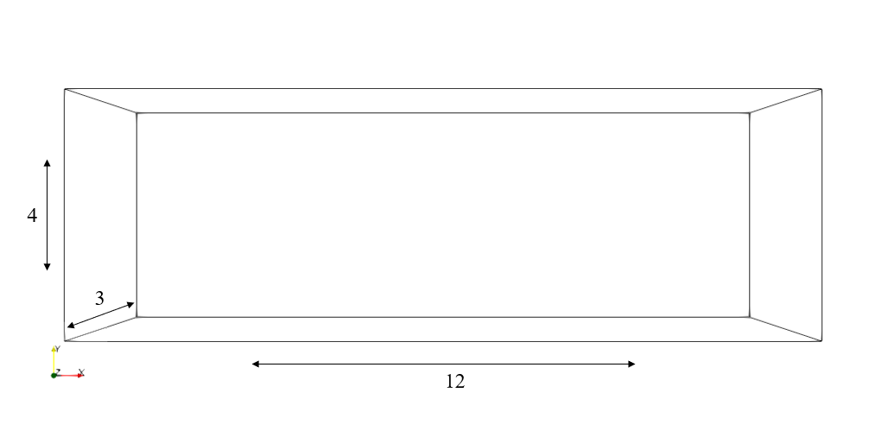
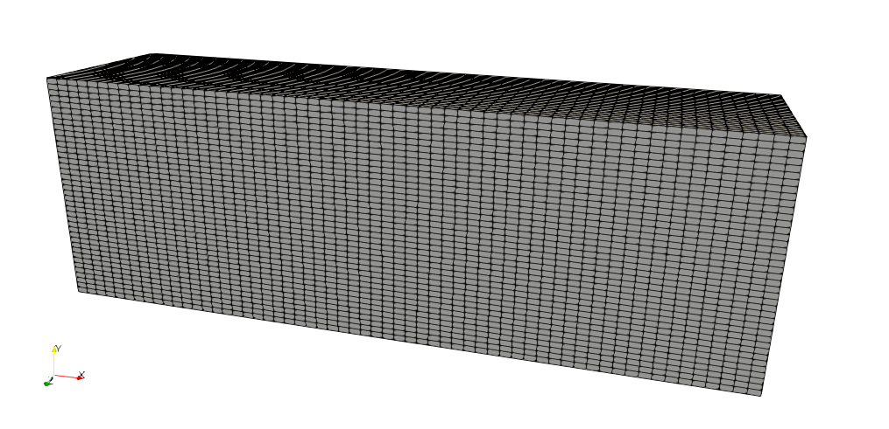
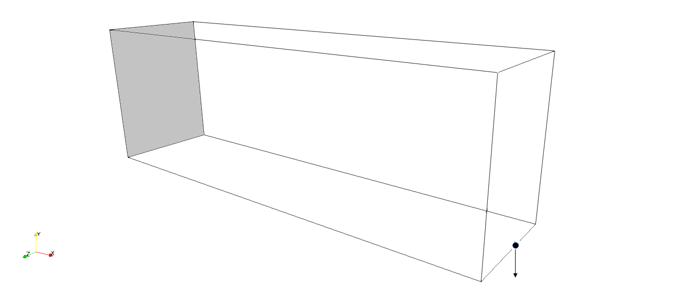
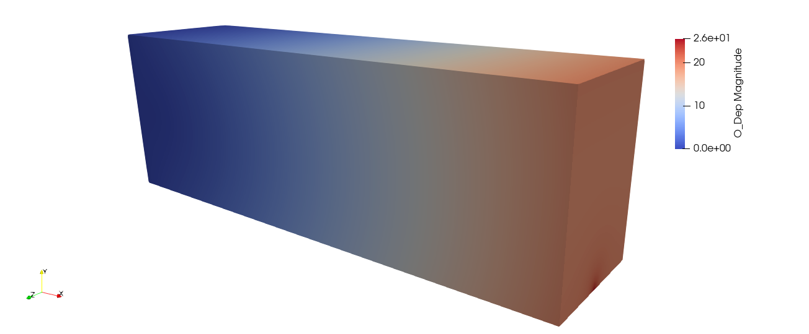
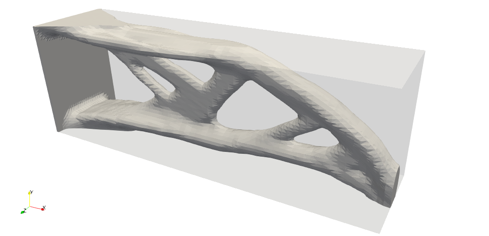
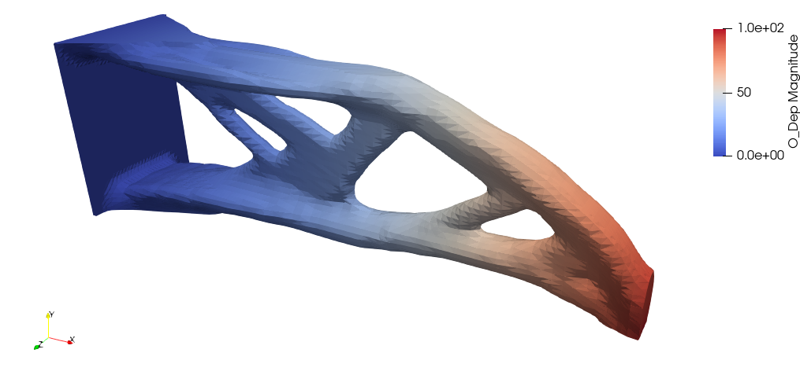

.. This file is subject to the terms and conditions defined in
   file 'LICENSE', which is part of this source code package.

Topology optimization of a 3D cantilever beam using structured level sets
=========================================================================

The goal of this tutorial is to run a topology optimization of a 3D cantilever beam using structured level sets.

Test case
~~~~~~~~~~~~~~~~

Consider the following specifications

* domain of size :math:`12` m :math:`\times 4` m :math:`\times 3` m
* elastic material with Young modulus equal to :math:`1` Pa and Poisson ratio equal to  :math:`0.3`
* beam clamped on the plane :math:`x = 0` m and submitted to a vertical load g = :math:`(0, 0,  -1000)` N on the point :math:`(12, 0, 1.5)`
* minimization of the elastic compliance under a volume constraint

Data setting : header
~~~~~~~~~~~~~~~~~~~~~~~~~~~~~~~~

At first, we start by editing a Liu_Tovar_2014_Cantilever_T4_C1.xml file.

The data file starts with the following header

.. code-block::

    <data dim="3" debug="False">

Data setting : implicit zones
~~~~~~~~~~~~~~~~~~~~~~~~~~~~~~~~

Define implicit zones

.. code-block::

    <Zones>
        <AABox id="10" origin="0. 0.05 0.05" size="12 3.9 2.9" desc="Init" />
        <Gyroid id="100"  desc="Init" scale="0.031831" />
        <Symmetric id="101" z="100" center="12 0 1.5"/>
        <Intersection id="1" z="10 101"/>
        <Plane id="2" point="0.1 0. 0." normal="1. 0. 0." desc="Block"/>
        <Cylinder id="3" center1="12 0 1.47" center2="12 0 1.53" radius="0.03" desc="Force"/>
        <Union id="4" z="2 3"/>
        <Union id="5" z="1 4 "/>
    </Zones>

Data setting : grids
~~~~~~~~~~~~~~~~~~~~~~~~~~~~~~~~~~~~~~~~~~~~~~~~~~~~~~~~~~~~~~~~~~~~~~~~~~~~~~~~~~~~~~~~~~~~~~~~

Define the background mesh which is a uniform grid

.. code-block::

    <Grids>
        <Grid id="1" n="61 41 31" origin="0. 0. 0." length="12 4 3"/>
    </Grids>

    Grid dimensions

    Structured mesh

Data setting : levelsets
~~~~~~~~~~~~~~~~~~~~~~~~~~~~~~~~

Define the level set together with a set of options. By default the level set is structured.

.. code-block::

    <LevelSets>
        <LevelSet id="1" support="1"/>
    </LevelSets>

Data setting : physical problems
~~~~~~~~~~~~~~~~~~~~~~~~~~~~~~~~~~

Define the physical problem, which is a linear elastic static FEA problem.

We define one dirichlet condition and one neumann condition.

By default we use linear elements.

The option eVoid="0.001" means that the density of the Ersatz material equals 0.001.

.. code-block::

    <PhysicalProblems>
        <Structured id="1" grid="1" type="static_elastic" eVoid="0.001" narrow=".2">
             <Dirichlet zone="2" dofs="0 1 2" val="0.0"/>
             <Neumann   zone="3" dofs="1" val="-1000"/>
        </Structured>
    </PhysicalProblems>

    Boundary conditions for the elastic problem. Clamped zone in light grey (left) and nodal force (right)

    Displacement field computed on the full design space

Data setting : outputs
~~~~~~~~~~~~~~~~~~~~~~~~~~~~~~~~~~

Define the desired output

.. code-block::

    <Outputs>
       <Output id="2" name="Liu_Tovar_2014_Cantilever_T4_C1.xdmf"/>
       <Output id="3" name="Liu_Tovar_2014_Cantilever_T4_C1.csv" nTag="NT3" />
       <Output id="1" name="PROXY" outputs="2 3"/>
    </Outputs>

Data setting : optimization problems
~~~~~~~~~~~~~~~~~~~~~~~~~~~~~~~~~~~~~~~~~~~~

Then, we define the optimization problem by entering the objective, the constraints, the initial levelset, the implicit zones, the output and a set of options.

Note that we have to define an upper bound value for the constraint.

Note that, since the constraint is a physical criterion, we precise which physical problem should be used with the keyword  useProblem="1".

.. code-block::

    <OptimProblems>
        <OptimProblem type="TopoGeneric" id="1"
            OnZone="4"
            useLevelset="1"
            e2="0.001"
            output="1">
          <Objective  type="Compliance"  name="Compliance" useProblem="1" />
          <Constraint type="Volume"     name="Volume"   upperBound="21.6"  desc="0.15*voltotal= 0.15*12*4*3=21.6"/>
       </OptimProblem>
    </OptimProblems>

Data setting : optimization algorithms
~~~~~~~~~~~~~~~~~~~~~~~~~~~~~~~~~~~~~~~~~~~~

Then, we define the optimization algorithm which is linked to the optimization problem

.. code-block::

    <TopologicalOptimizations>
 	<OptimAlgoNullSpace id="1"
        useOptimProblem="1"
        numberOfDesignStepsMax="60"/>
    </TopologicalOptimizations>

Actions setting
~~~~~~~~~~~~~~~~

Here we declare actions which must be runned. At first, we create a nodal tag labeled "NT3" from the implicit zone "3" of the level set "1"

.. code-block::

    <Actions>
        <Action type="CreateTagsFromZones" ls="1" nodalTags="3" />

Then, the level set "1" is initialized with the implicit zone "5" and redistanciated to generate a signed distance function

.. code-block::

        <Action type="InitLevelset" ls="1" zone="5"/>
        <Action type="UpdateDistance" ls="1" />

Then, we run the topology optimization

.. code-block::

        <Action type="RunTopoOp" TopoOp="1"/>

Eventually the optimal shape is exported in stl format

.. code-block::

        <Action type="SaveShapeToFile" ls="1" filename="Liu_Tovar_2014_Cantilever_T4_C1.stl"/>
    </Actions>
 </data>

Run
~~~~~~~~~~~~~~~~

To run the script using the command line application execute in a terminal

.. code-block::

    OpenPiscoCL Liu_Tovar_2014_Cantilever_T4_C1.xml

To run the script using the GUI application execute in a terminal

.. code-block::

    OpenPisco Liu_Tovar_2014_Cantilever_T4_C1.xml

Output
~~~~~~~~~~~~~~~~

After running the tutorial script the following output files have been created in the working directory

* Liu_Tovar_2014_Cantilever_T4_C1.xml.log     : run summary
* Liu_Tovar_2014_Cantilever_T4_C1.stl         : optimal shape in stl format
* Liu_Tovar_2014_Cantilever_T4_C1.xdmf        : (heavy) file containing the mesh and fields at each iteration in xdmf format
* Liu_Tovar_2014_Cantilever_T4_C1.csv         : convergence history in csv format

    Visualisation of the optimal design in Paraview

    Visualisation of the displacement field in Paraview

The demo xml file created is available in the module  :py:meth:`OpenPisco.Demos` of the OpenPisco Python library [1]_ .

.. [1] https://gitlab.com/openpisco/openpisco/-/tree/master/src/OpenPisco/Demos/

