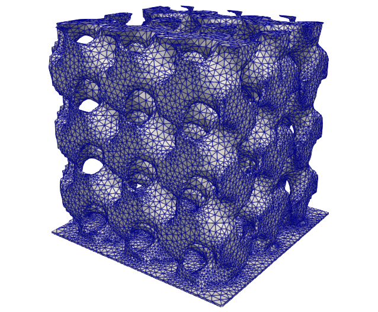

.. This file is subject to the terms and conditions defined in
   file 'LICENSE', which is part of this source code package.

Body-fitted Level Set
=======================

In the conformal, or body-fitted, case the support mesh contains the negative part of the level set as a submesh and a triangulation of the 0 isovalue is available.

    Body-fitted Level Set
