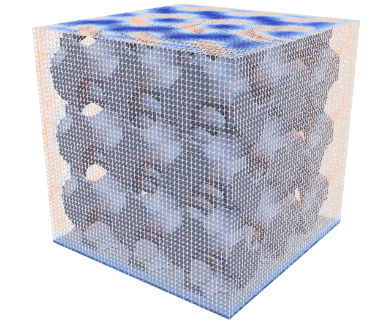

.. This file is subject to the terms and conditions defined in
   file 'LICENSE', which is part of this source code package.

Structured Level Set
=======================

In the structured setting the support mesh is a structured uniform tetrahedral grid.

    Structured Level Set