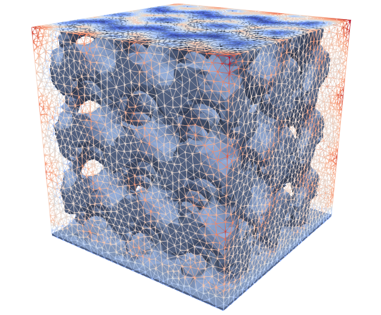

.. This file is subject to the terms and conditions defined in
   file 'LICENSE', which is part of this source code package.

Unstructured Level Set
=======================

In the unstructured setting the support mesh is an unstructured tetrahedral mesh.

    Unstructured non conformal Level Set

