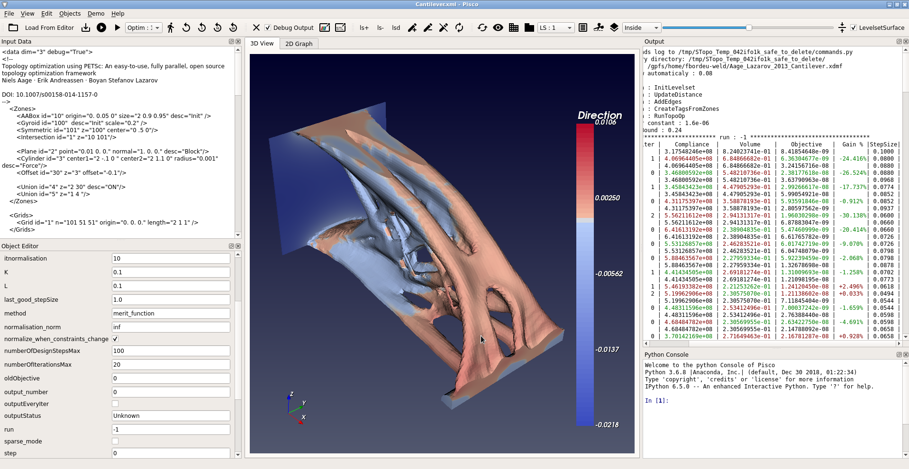

.. This file is subject to the terms and conditions defined in
   file 'LICENSE', which is part of this source code package.

OpenPisco GUI
=============

The OpenPisco GUI is the graphical user interface of the OpenPisco platform.

Built on top of the OpenPisco computational core,
it exposes the same capabilities as the command-line and Python interfaces while
offering a more user-friendly experience.

Relationship with the DSL
-------------------------

The OpenPisco GUI and OpenPiscoCL share the same underlying study description
model. Studies created in the GUI can therefore be exported, modified, and
reused through the command-line interface. Similarly, studies described using
the OpenPisco DSL can be loaded and visualized directly within the GUI.

This interoperability allows users to combine interactive and scripted workflows
depending on their needs.

Getting Started
---------------

For a first introduction to the GUI, we recommend following the tutorials, which
illustrate the creation and execution of complete topology optimization studies.

Users interested in understanding the underlying study description format should
refer to the :doc:`OpenPiscoCL <OpenPiscoCL>` documentation and the
:doc:`XML Reference Guide <XmlReference>`.

    OpenPisco (GUI) overview
