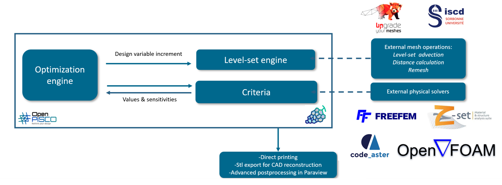
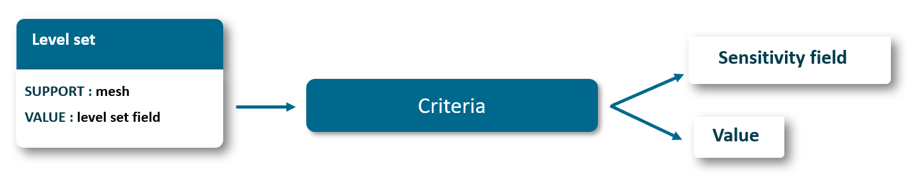

.. This file is subject to the terms and conditions defined in
   file 'LICENSE', which is part of this source code package.

****************************************
Software Design
****************************************

Architectural Principles
""""""""""""""""""""""""

OpenPisco has been designed around three core principles:

* **Modularity**: components can be developed and used independently.
* **Interoperability**: solvers, optimization algorithms, and criteria can be replaced with alternative implementations.
* **Extensibility**: new functionalities can be introduced through plugins and custom modules without modifying the existing code base.

This architecture enables OpenPisco to serve both as an optimization platform and as a collection of reusable numerical tools.

Core Architecture
"""""""""""""""""

The OpenPisco architecture revolves around three core subsystems:

* The optimization engine.
* The level-set engine.
* The criteria framework.

Together, these components provide the infrastructure required to formulate,
solve, and monitor topology optimization problems.

The figure below describes the interactions between these components from a macroscopical point of view.

    Interactions between OpenPisco main components

Criteria Framework
""""""""""""""""""

Criteria are the primary mechanism used to evaluate a design.

From the perspective of the optimization algorithms, every criterion exposes
two fundamental operations:

* Evaluation of its numerical value.
* Computation of its sensitivity.

This abstraction allows optimization algorithms to manipulate physical and
geometrical criteria in a unified manner, regardless of the underlying
implementation.

    Inner API used when updating criteria

A criterion may be used either as:

* an objective function,
* a constraint.

From the optimization algorithm perspective, no distinction is made between
these two use cases. Each criterion is responsible for managing its own
physical analyses and adjoint computations when required.

Package Structure
"""""""""""""""""""""""

We introduce briefly the repositories within the module and refer to the related documentation for more details.
The library is organized as follows

.. code-block:: bash

    OpenPisco
    ├── Actions
    ├── MuscatExtentions
    ├── CLApp
    ├── Demos
    ├── ExternalTools
    │   ├── Code_Aster
    │   ├── FreeFem
    │   ├── Zset
    │   ├── OpenFOAM
    ├── Optim
    │   ├── Algorithms
    │   ├── Criteria
    │   ├── Problems
    ├── PhysicalSolvers
    ├── QtApp
    ├── Structured
    ├── TestData
    ├── Unstructured

Core Modules
============

The OpenPisco source tree is organized into several modules, each dedicated to
a specific aspect of the platform.

.. grid:: 3
   :gutter: 3

   .. grid-item-card:: ⚙️ Actions

      Collection of reusable operations accessible from the Python API,
      and the OpenPiscoCL application.

   .. grid-item-card:: 🧩 MuscatExtensions

      OpenPisco-specific extensions built on top of Muscat, including mesh
      utilities, IO for med format.

   .. grid-item-card:: 📜 CLApp

      Implementation of the OpenPisco Domain-Specific Language (DSL) and
      command-line workflow execution.

   .. grid-item-card:: 🎓 Demos

      Collection of examples and reference use cases.

   .. grid-item-card:: 🔌 ExternalTools

      Interfaces and solver-specific resources for external software such as
      Code_Aster, FreeFem++, Zset, and OpenFOAM.

   .. grid-item-card:: 📈 Optim

      Optimization algorithms, criteria, optimization problems, and design
      update strategies.

   .. grid-item-card:: 🧮 PhysicalSolvers

      Unified interfaces to the physical analyses supported by the platform.

   .. grid-item-card:: 🖥️ QtApp

      Implementation of the OpenPisco graphical user interface.

   .. grid-item-card:: 🟦 Structured

      Algorithms and utilities dedicated to level sets defined on structured
      meshes.

   .. grid-item-card:: 🧪 TestData

      Reference datasets and validation cases used for testing.

   .. grid-item-card:: 🔺 Unstructured

      Level set, remeshing, advection, regularization, and mesh processing
      algorithms for unstructured meshes.
