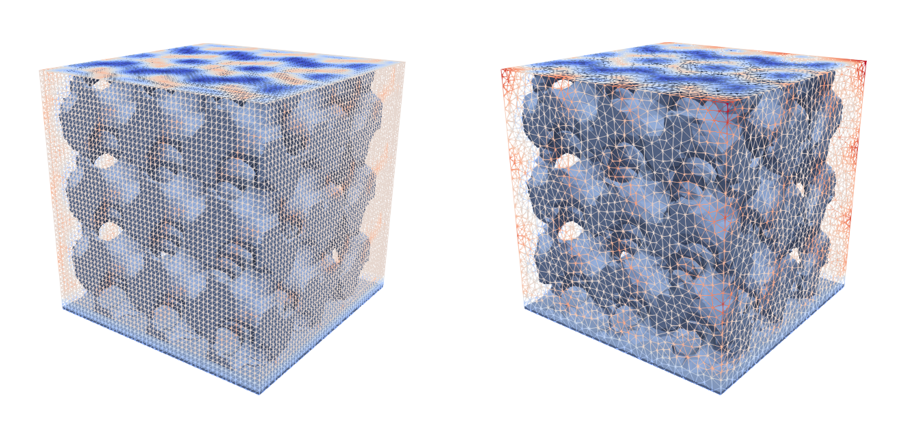
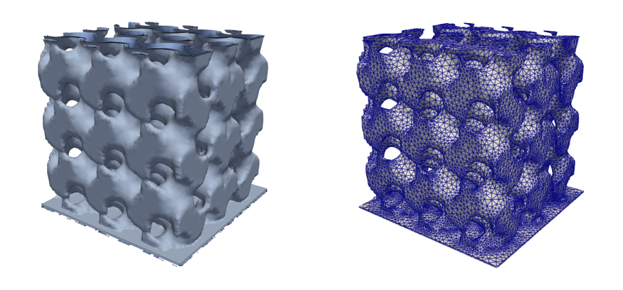

********************************************************************************
Topology Optimization
********************************************************************************

It is by no mean our objective to be exhaustive regarding shape and topology optimization in this modest introduction. For detailed information regarding the various aspects inherent to such a vast field we refer for instance to [1]_ and [2]_ and the reference therein.

Topology optimization in a nutshell
""""""""""""""""""""""""""""""""""""""""""""""""""""""""""""""""""""""""""""""""""""""""
Topology optimization is devoted to the optimal design of structures. It aims at finding the best material distribution inside a working domain while fulfilling mechanical, geometrical and manufacturing specifications.

In the literature and the industry, it is mainly motivated by the following aspects:

* Economical/ecological context: increase in the cost of raw materials and the necessity to decrease energy consumption
* Design acceleration: alleviate workload at early stages of design to focus afterward on a physical-informed relevant initial design guess
* Structure optimization automatization: domain specific intuition/skills and experience allow to manually optimize a structure through numerous trials and errors but slow, tedious and not within anyone's grasp

The generic optimization problem associated can be described as followed

.. math::

    \min_{\Omega \in \mathcal{O}_{ad}}J(\Omega)\quad {\rm s. t.}\quad  C(\Omega)<0;

where

* :math:`\Omega` is the shape, or the design variable;
* :math:`J(\Omega)` is an objective function to be minimized;
* :math:`C(\Omega)` is a constraint set;
* :math:`\mathcal{O}_{ad}` is a set of admissible shapes;

.. note::
   While it is mainly used in structural mechanics in this library, it can also be used indifferently for CFD, design of cooling devices, biology, electromagnetism. This a quite a general framework.

Classically, the resolution of such a problem is done iteratively; each iteration aims to determine a "better" shape than the current solution. Through this iterative process, a descent direction is computed which requires one or several evaluations of the criteria involved in this optimization problem.

One notable issue in this field is that, in general, there is no global minima for this optimization problem. It means that, while you could improve the design by simply deforming the shape without altering the topology, doing so may lead to a falling into a "bad" local minima. 
To account for topology changes during the optimization, techniques abound in industry and engineering. Here, level set based methods, briefly described thereafter, are used.

.. You can find below a description of the whole general procedure when using a topology optimization with level set

.. .. figure:: images/GenericAlgoLevelSet.PNG
..     :width: 700px
..     :align: center
..     :height: 350px
..     :alt: alternate text
..     :figclass: align-center
    
..     Algorithmic procedure in topology optimization with level set.

.. Depending on the type of topology optimization with level set considered, several blocks slightly differ but this general description still holds.

Principles of topology optimization with level sets
""""""""""""""""""""""""""""""""""""""""""""""""""""""""""""""""""""""""""""""""""""""""
Let :math:`\phi: D\rightarrow \mathbb{R}` be a scalar function and :math:`\Omega\subset\mathbb{R}^3`, a bounded domain strictly included in :math:`D`. Let :math:`x` be a point of :math:`D`, :math:`\phi` is
	
* Strictly negative if :math:`x` is part of :math:`\Omega`
* 0 if :math:`x` belong to the boundary of :math:`\Omega`
* Stricly positive, else.

Typically, we consider the signed distance function for :math:`\phi` , i.e. the euclidian distance from :math:`x` to the boundary of :math:`\Omega`. 

OpenPisco proposes two topology optimization technologies based on the level set method. 

First approach: Shape capturing with fixed mesh
--------------------------------------------------------------------------------------------------------------------------------
In the first one, the whole set of admissible shapes :math:`\mathcal{O}_{ad}` is assumed to lie within the computational domain :math:`D` equipped with a fixed mesh. A new shape arising from the iterative optimization process is described by the value of the level set function at the vertices of this very mesh. 

As the evaluation of the optimization criteria requires the computation of the PDEs solution by the physical solver, a computational mesh of the domain :math:`\Omega` is required (no mesh of the shape is available)
To handle this, the original problems are approximated by PDEs on the whole domain :math:`D` as a whole instead of :math:`\Omega`

    
    Level set discretization on structured mesh (left), Level set discretization on unstructured mesh (right)

Second approach: Shape tracking with body-fitted meshes
--------------------------------------------------------------------------------------------------------------------------------
In this approach, the level set method is coupled with a remeshing routine for the reconstruction of a body-fitted mesh, meaning that:

* The shape is exactly meshed at each step of the underlying optimization process
* The computational mesh of the domain :math:`\Omega` is available 

The domain evolution strategy is based on two complementary representations of the design variable: 

* The level set description: allows easily arbitrary topology changes (merging/splitting the interfaces)
* An explicit mesh discretization: boundary fits smoothly the interface by an explicit discretization of the zero isovalue of the implicit domain

Since the structural interface is explicitly known at each step of the iterative procedure, 
the body-fitted approach simplifies the evaluation of the mechanical quantities of interest and provides a clear definition of the shape. This implies that the mechanical evaluation is not hindered by the underlying topology optimization method; in fact, it is completely independent.

    
    Isovalues of the level set function (left), body-fitted mesh (right)

Obviously, in comparison with the first approach, a remeshing operation is required to recover a body-fitted mesh.

.. [1] G. Allaire, C. Dapogny, F. Jouve, Shape and topology optimization, in Geometric partial differential equations, part II, A. Bonito and R. Nochetto eds., pp.1-132, Handbook of Numerical Analysis, vol. 22, Elsevier (2021).
.. [2] G. Allaire, Conception optimale de structures, vol. 58 of Mathematiques & Applications (Berlin) [Mathematics & Applications], Springer (2007). 