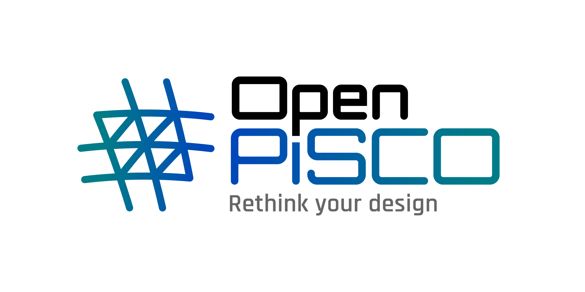

.. This file is subject to the terms and conditions defined in
   file 'LICENSE', which is part of this source code package.

OpenPisco
=========

A modular platform for topology optimization based on the level set method.

OpenPisco is an open and extensible research and development platform designed
for the development of topology optimization
methodologies. It provides a unified environment combining optimization
algorithms, direct and adjoint analyses, remeshing tools and algorithms for level sets.

Core principles
---------------

🧩 **Modularity**
   Assemble workflows from independent and reusable components.

🔄 **Interoperability**
   Easily replace solvers, criteria and optimization algorithms.

🚀 **Extensibility**
   Integrate custom functionalities through a plugin-oriented architecture.

🐍 **Python-first**
   Rapid prototyping combined with a rich scientific ecosystem.

.. grid:: 3

   .. grid-item-card:: 🚀 Getting Started
      :link: Installation
      :link-type: doc

      Install OpenPisco and run your first study.

   .. grid-item-card:: 🖥️ User Interfaces
      :link: OpenPiscoApplications
      :link-type: doc

      GUI, command line and Python API.

   .. grid-item-card:: 📚 Tutorials
      :link: examples-gallery
      :link-type: ref

      Learn through practical examples.

.. toctree::
   :hidden:
   :maxdepth: 4
   :caption: Getting Started
   :name: main_toc

   Intro
   Installation
   OpenPiscoApplications
   Examples/index
   XmlReference

.. toctree::
   :hidden:
   :maxdepth: 4
   :caption: Principles
   :name: principles_toc

   SoftwareDesign
   TopologyOptimization
   LevelSet/LevelSet
   Remeshing
   LagrangianMeshDisplacement
   OptimizationProblem
   OptimizationAlgorithms
   PhysicalSolvers
   Criteria

.. toctree::
   :hidden:
   :maxdepth: 4
   :caption: Developer Guide
   :name: dev_toc

   DeveloperGuide
   openpiscoQuickRef
   MuscatReference
   CreateYourOwnOptimizationCriterion
   InterfaceYourOwnOptimizationAlgorithm
   InterfaceYourOwnPhysicalSolver
   InterfaceYourOwnPhysicalAdjointCapabilitiesSolver
   AdditiveManufacturing

.. toctree::
   :hidden:
   :maxdepth: 4
   :caption: Package Tree
   :name: packtree_toc

   Package Tree